<!-- Languages: Deutsch · English (here) -->
[Deutsch](README.md) · **English**

<p align="center">
  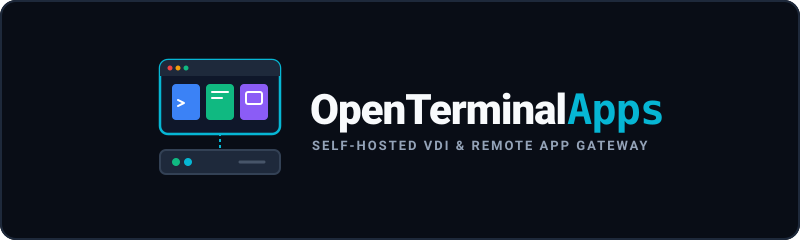
</p>

# OpenTerminalApps

A self-hosted platform that gives every user **their own Linux workspace in the browser**. Their
tools are installed in it — VS Code, VSCodium, JetBrains, Firefox, a terminal — and each one can be
streamed on its own, filling the window. They all share **one home**: the same projects, the same
SSH key, the same clipboard.

Alongside, single applications can be started as throwaway containers, and existing Kasm images as
well as whole registries can be connected — as an add-on, not as the foundation.

**Every workspace sits in its own network** behind a router: no company network, no neighbouring
session, no host — until someone explicitly allows it ([firewall.md](firewall.md)).

> **Status:** running and in use. 452 automated checks, 107 of them in a real browser.
> What is still missing is listed openly in [roadmap.md](roadmap.md) — none of it is glossed over.

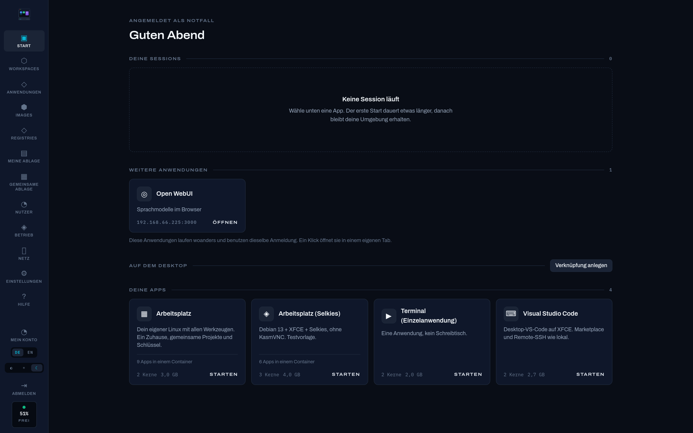

*The start page: your own running session with its applications, the cores and memory it got — and
what it may do on the network. Below, what else can be started.*

---

## Quick start

**Requirements** on a Linux host: `docker` with the Compose plugin (`docker compose version` must
answer), plus `git`, `make` and `openssl`. Ports **8443** and **8081** must be free — 443 is
deliberately left alone so an existing Kasm can keep running next to it. Both can be changed via
`OTA_HTTPS_PORT` and `OTA_HTTP_PORT` in `deploy/.env`.

Plus **30000–30019** as a pool for port forwards. The video stream needs **no** port of its own:
Selkies 2.0 transmits over WebSockets through the same HTTPS port as the interface. Only golden
images still built on the old base image with Selkies 1.6.2 need **3478** (TURN) and
**49160–49260/UDP**. If OTA sits behind a firewall with port forwarding, **443** is enough from the
outside — which ports go where, and what belongs in `deploy/.env` for it, is in
[chapter 24](docs/wiki/en/24-hinter-nat.md). And an address range for the workspace networks,
`10.99.0.0/16` by default — it must **not** overlap with the company network. Everything is
configurable and explained in [`deploy/.env.example`](deploy/.env.example) and
[chapter 2](docs/wiki/en/02-erste-schritte.md).

```bash
git clone https://github.com/bmetallica/openterminalapps.git
cd openterminalapps

sudo make setup                  # .env with secrets, certificate, directories
sudo make up                     # build and start the stack (a few minutes the first time)
sudo make admin NAME=yourname    # first administrator account
```

**Behind a corporate proxy**, three lines go into `deploy/.env` — `OTA_HTTP_PROXY`,
`OTA_HTTPS_PROXY` and above all `OTA_NO_PROXY`, so the services do **not** talk to each other
through the proxy. Without a proxy there is nothing to do; that is the default.
[Manual, chapter 21](docs/wiki/en/21-firmenproxy.md) also describes what OTA *cannot* solve there:
`docker pull` is done by the Docker daemon and needs its own configuration.

`make setup` **generates the secrets and fills them in itself** — nothing has to be added by hand
afterwards. Running it a second time leaves existing values untouched.

`sudo` is needed because OTA creates directories under `/srv/ota` and talks to the Docker socket.
Anyone in the `docker` group who created `/srv/ota` themselves can leave it out.

`make admin` creates **two** accounts and prints both passwords — they are shown only this once:

| Account | Where it lives | What for |
|---|---|---|
| `<yourname>` | in Keycloak | everyday access; the first sign-in immediately asks for your own password |
| `notfall` | locally in OTA | the way out if Keycloak ever does not answer |

The second one is not a gimmick: from the moment sign-in runs through another service, there has
to be a way in that works without it. It is reachable at `/notfall`, and every sign-in through it
is recorded in the audit log.

```
https://<host>:8443/            # redirects to the central sign-in
https://<host>:8443/notfall     # the local emergency access
```

**Import the root certificate once**, then the browser no longer warns — even after every later
certificate change:

```bash
sudo cp deploy/certs/ota-ca.crt /usr/local/share/ca-certificates/ota-ca.crt   # Linux, system-wide
sudo update-ca-certificates
```

In the browser: Settings → Certificates → Authorities → import `deploy/certs/ota-ca.crt`, tick
"Trust this CA to identify websites".

**Is it running?**

```bash
make ps                          # all services should be "healthy"
curl -k https://localhost:8443/healthz
```

The answer names four things: `db`, `agent`, `keycloak` and the overall state. If it says
`"keycloak":"nicht erreichbar"` (unreachable), the realm is not set up yet or the service is not up
yet — catch up with:

```bash
sudo make identity               # realm, clients, roles; idempotent
```

`make up` does that by itself and waits until Keycloak answers (about half a minute on the first
start).

If something is stuck: `make logs` and [manual, chapter 12](docs/wiki/en/12-fehlersuche.md) — it
lists real failures from operation with symptom, cause and fix.

### The first workspace

**`make up` builds the base image on the first start** — `ota/base-desktop:1`, Debian 13 + XFCE +
Selkies, without KasmVNC. That takes a few minutes and only happens if it is missing; afterwards it
is available under **Workspaces**. Rebuilding by hand works at any time:

```bash
scripts/build-desktop-image.sh --pruefen      # builds and checks 19 points against the contract with the agent
```

A Kasm image is **not** needed for this. Those remain possible, but they are the exception — for
ready-made catalogs and for migrating ([chapter 9](docs/wiki/en/09-kasm-images-und-registries.md)).

Then: **Workspaces → Create** — the button immediately creates a template and uses your own base
image for it, otherwise another one that looks like a desktop. In the editor assign the group
`users` and enable it, then start it under **Start** and enable the applications via **Software →
Look inside the image**. In detail in [manual, chapter 2](docs/wiki/en/02-erste-schritte.md).

## Updating

Fetch a new version from the repository:

```bash
cd openterminalapps
sudo make backup          # back up first, then change
git pull
sudo make update          # complete .env, build, start
```

From the first step on, every OTA page (dashboard, sign-in, every session) shows a banner
"**Attention!** OTA update in progress, please reload all OTA pages once this message has
disappeared." It disappears as soon as the new API is healthy; if the update fails, it stays
([chapter 11](docs/wiki/en/11-betrieb.md#the-banner-during-an-update-)).

`make update` does three things in this order, and the order is not arbitrary:

1. **Add missing settings.** If a version brings new values in `deploy/.env.example`,
   `make update` adds them with sensible defaults. **Existing values stay untouched** — including
   the secrets. If this happened only after building, a service would start against a variable
   that does not exist yet.
2. **Build and start — with security updates.** The third-party services (Postgres, Keycloak,
   Traefik …) are pulled fresh within their version line, the own images on a fresh base and with
   the week's package updates. Without network it continues with what is there. The database
   migrates by itself: Alembic when the API starts, and OTA adds missing columns from the model.
   There is no manual migration step.
3. **Say what does *not* happen by itself.** See below.

### What an update does not touch

| | Why, and what to do |
|---|---|
| **Running sessions** | They keep their image until they are ended. That is intentional: nobody should be interrupted in the middle of their work. Whoever wants the changes right away ends their workspace and starts it again. |
| **The base image** | Is not rebuilt on every update — it takes minutes, and most versions do not touch it. `make update` does **check** whether the build recipe is newer than the built image, and says so. Build with `scripts/build-desktop-image.sh --pruefen`. |
| **The workspace images** | A new base image only takes effect once the images derived from it are rebuilt — in administration under **Software**. |
| **`deploy/.env`** | Is only extended, never overwritten. Whoever wants to change a setting does it themselves; the template next to it explains every one. |

### Switching to a corporate proxy later

The same way, while running and without reinstalling: enter the three lines in `deploy/.env`,
`sudo make update`. Services and **new** sessions pick it up immediately; running ones keep their
state until their next start. The base image does **not** have to be rebuilt for this — the proxy
is never baked into the image. Switching back is the same way.

Measured in both directions; the pitfalls are in [chapter 21](docs/wiki/en/21-firmenproxy.md).

### Behind a firewall with NAT

Users come in from outside via the firewall's address, OTA sits behind it, perhaps with a reverse
proxy in front and the directory on the other side. What needs forwarding from the outside is
**443** (to the proxy, with WebSockets — since Selkies 2.0 the video stream goes through there
too); towards the outer network Keycloak needs **636** to the directory. Only as long as golden
images with Selkies 1.6.2 are running, **3478/TCP** directly to the OTA host is added, and two TURN
addresses in `deploy/.env`, the firewall's and the host's own:

```bash
OTA_TURN_HOST=10.50.0.33        # the firewall — this is how browsers see TURN
OTA_TURN_BIND=192.168.1.22      # the host — coturn binds to this
OTA_TURN_PROTOCOL=tcp
OTA_TURN_ICE_POLICY=relay
OTA_TRUSTED_PROXIES=192.168.1.23/32
```

Hairpin NAT on the firewall is not needed: the workspaces' router redirects the published address
to the host itself. The directory's CA belongs in `deploy/keycloak-truststore/`. Complete port
lists, an nginx example and the check: [chapter 24](docs/wiki/en/24-hinter-nat.md).

### Enabling root workspaces

Root and Docker inside the workspace need **Sysbox** on the host. During installation the package
wants to restart Docker and suggests deleting all containers for that — the script avoids this and
does not touch any container:

```bash
sudo scripts/sysbox-einrichten.sh --pruefen          # look at the prerequisites
sudo scripts/sysbox-einrichten.sh --live-restore     # set up
sudo make up                                         # builds ota/base-desktop-root:1
```

Then create a template of the class "Root with Docker" and grant the permission "Use root
workspace" to the groups that should get it. In detail in
[chapter 25](docs/wiki/en/25-root-arbeitsplatz.md).

### Turning on the package mirror

The own package repository always runs — it is how `ota-selkies`, the streaming server, gets into
the workspaces. A **mirror** of Debian 13 and Docker's repository is an add-on, off by default. A
full mirror needs roughly 100 to 130 GB:

```bash
# in deploy/.env
OTA_REPO_SPIEGEL=1
OTA_REPO_ROOT=/srv/ota/repo
sudo make update
```

Then sync once under **Administration → Package sources**. In detail in
[chapter 26](docs/wiki/en/26-paketquellen.md).

### When something goes wrong

```bash
sudo make ps              # which service is not up?
sudo make logs            # what does it say?
```

`scripts/restore-db.sh` restores the backup from above. **Users' profiles** live under
`/srv/ota/profiles` and are not touched by an update — they even survive a complete rebuild of the
stack.

Going back to the previous version is `git checkout <old-state> && sudo make update`. What does
**not** go back is the database: new columns stay. They do not bother an older version, but data
that did not exist before is simply there.

## What it does

**The workspace**
- One container per user, every application on its own display, started only when needed
- Every application in its own browser tab, with its own address — and can be pinned to the desktop
  as a shortcut (PWA)
- The remote screen **grows with the window**, no black border, no scaling
- Clipboard in both directions, also between two applications in the same container
- Classic XFCE desktop as an additional view
- **Root workspace for developers**: root, **Docker and `docker compose`** inside the container —
  under Sysbox, so without `--privileged` (root in the container is unprivileged on the host).
  Ending it **stops** instead of deleting: what gets installed stays, at a fixed address; "Rebuild"
  brings in a new base image. The inner containers go through the same router and the same network
  rules ([chapter 25](docs/wiki/en/25-root-arbeitsplatz.md))
- **Own package repository** (always on): **your own `.deb` packages** via drag & drop, **pinned
  snapshots** with rollback and reproducible images, and the package **`ota-selkies`**, which
  brings the streaming server into images and upgrades root workspaces when they resume. A
  **mirror** of Debian 13 including security updates and Docker's repository is an add-on (off by
  default): workspaces then install even when something is missing outside — mode "mirror first"
  or "mirror only". Syncing is manual; the mirror's age turns yellow and red
  ([chapter 26](docs/wiki/en/26-paketquellen.md))

**Administration**
- Resources **per user and workspace**: user A gets 2 cores, user B one
- **News** — announcements from the administrators to everyone, written in Markdown right on the
  page, with drafts, pinning and a sidebar badge for unread posts ([chapter 11](docs/wiki/en/11-betrieb.md#news-))
- **User handbook** — chapters of their own for users: getting started, account, files, root
  workspace, Git and AI, using a session, help with problems, terms ([chapters 29 to 36](docs/wiki/en/29-los-gehts.md))
- **Live utilisation under Operations** — bars for CPU, RAM and network per workspace and for the
  host, with a warning as soon as the CPU limit throttles a container ([chapter 11](docs/wiki/en/11-betrieb.md#live-utilisation-operations--workspaces-))
- **Cores as a weight, not a cap** — on an idle host a workspace may use up to four times as much,
  on a busy one the kernel shares proportionally; no more stutter while the host is half idle
  ([chapter 5](docs/wiki/en/05-workspaces-verwalten.md#resources))
- **Duplicate workspaces** — with apps, run-once scripts, allocations, groups and skeleton, e.g. a
  fully set-up root workspace as the template for the next one; everyone can **rename their tiles
  for themselves** ([chapter 5](docs/wiki/en/05-workspaces-verwalten.md#duplicating-))
- **Several workspaces at once despite shared data** — the *Shared data* persistence: own settings
  per workspace, `Desktop`, `Documents` and the like from the shared home. Two root workspaces of
  one person can run side by side ([chapter 5](docs/wiki/en/05-workspaces-verwalten.md#resources))
- **Quota per home** and a lower limit for free disk space — an understandable refusal instead of
  a container that stalls mid-work while writing. **Core dumps** of crashed programs (`core.<pid>`)
  no longer fill any home: new containers do not create them, and whatever still appears in
  existing ones OTA cleans up before every measurement and daily
  ([chapter 11](docs/wiki/en/11-betrieb.md#ota-cleans-up-core-dumps-itself-))
- **Visibility per application and group**, for when a licence does not cover everyone
- **Two-factor enforceable per group**, either with a **passkey** (fingerprint, face, security
  key) or a one-time password — offered, not required; `/healthz` and `/metrics` for monitoring
- Users, groups and permissions; administrators are `root` in their own container
- **Operations → Workspaces**: all workspaces of all users, running and stopped, with storage and
  "last active"; start, stop, delete — and a **root web terminal** in the browser whose input is
  logged per workspace and can be exported
- **Central sign-in through Keycloak**, shipped in the stack — or connect an existing one. OTA is
  its administrator: accounts, groups and the **AD connection** are set up in OTA's interface, the
  Keycloak console stays closed for everyday use — **but it is still reachable** (`/auth/admin/`),
  and deliberately so: whoever walls it off locks themselves out when something breaks. What
  operations owe it is in [chapter 18](docs/wiki/en/18-zentrale-anmeldung.md)
- **One way in for everyone:** an account created in OTA is created in Keycloak — with the
  password administration assigns. Everyone changes password and second factor under **My
  account**, which leads to Keycloak (for directory accounts: in the directory). Old local accounts
  move over **with their password** on their next sign-in; only the emergency account stays local
- **Emergency access** at `/notfall`: a local account that works without Keycloak. Without it, an
  installation with a broken sign-in configuration could no longer be entered. In front of it a
  brake (ten attempts per minute and sender), and the lockout after failed attempts applies per
  **(account, sender)** — so it cannot be turned against a colleague
- A directory entry **cannot take over an existing account by itself**, not even with the same
  name. Administration can, however, **link a domain account to an existing account**: afterwards
  the old account signs in through the directory and keeps its containers, home and shelves.
- **OTA Git (Forgejo)**, switchable on and off in the menu:
  - Runs under its own subdomain behind the same entrance as OTA.
  - Sign-in with the OTA credentials through Keycloak, only for entitled groups.
  - OTA creates the accounts and locks instead of deleting. OTA admins are admins there too.
  - Workspaces and root workspaces get Git preconfigured: a token per workspace, revoked when it
    ends; SSH only inside the container network. Other Git servers stay untouched.
  - See [chapter 27](docs/wiki/en/27-git.md).
- **IDE-AI**, can be turned on and off under Settings: an AI assistant (Continue) in VS Code,
  VSCodium and PyCharm, connected to your own AI server (vLLM, llama.cpp or any other with an
  OpenAI interface):
  - Models as a drop-down, context window and response length per model; plus tools
    (agent mode), temperature, timeout, rules and entitled groups.
  - The packages come from the own package source into every workspace with a matching editor,
    also into Ubuntu and Kasm images; root workspaces move up when resuming.
  - The firewall allows the AI server while IDE-AI is on. Continue's telemetry off.
  - See [chapter 28](docs/wiki/en/28-ide-ai.md).
- **Software monitoring:** every hour OTA records which applications are installed in each running
  workspace (apt, start menu, Flatpak, Snap), without versions. There is a whitelist that can be
  filled from the current state. Whatever is not on it, administrators see on the dashboard and
  approve with one click. If it gets uninstalled, the alert disappears by itself
- **External web applications** in the catalog (Open WebUI, Grafana, …): OTA creates the OIDC
  access and decides who sees the tile **and who may sign in there**. Keycloak checks this itself,
  even when the address is opened directly; without a group nobody gets in. The OTA groups are in
  the token, so the application can hang something on them, such as an MCP server in Open WebUI.
  What someone may do inside is up to the application. OTA does not rebuild its permission model
- **Groups from the directory** (OpenLDAP or AD): an OTA group gets its members from LDAP groups,
  in addition to those added by hand. That applies immediately at sign-in and via sync at an
  adjustable interval (15 min to 1 day) or at the push of a button. Whoever is missing from the
  directory is disabled, never deleted. Accounts without a group see an empty dashboard with a note
- Sign-in timeout adjustable (30 min to 48 h), rolling — whoever is working is not signed out
- Interface in German and English, switchable at the top right; a **default language** for
  everyone who does not switch themselves (Settings → Language), which also applies to the
  Keycloak sign-in page and the manual. **Dark or light** (or match the system) — both switchable
  even before signing in
- The manual lives **inside the program**, in German and English, filtered by permissions
- **My account** for everyone: change your own password, set up two-factor with recovery codes

**The workspaces' network**
- **Its own network per workspace**, all ending in one router. No company network, no
  neighbouring session, no host — and not because a rule forbids it, but because there is no other
  path: the networks are `internal`, Docker sets up neither NAT nor a default route there
- **The base rule set is visible in the interface** — what OTA opens for itself (TURN, its own
  address, name service, proxy, time server), each line with destination, ports, **reason and
  origin**. Derived from `.env`, so it can be seen but not changed
- **Profiles per template** in three levels: *isolated* (only what OTA needs), *internet* (the
  default) and *off* — the last one lifts everything, requires a justification and is recorded in
  the audit log
- **Rules by address, range or name**, global for everyone or per profile. Names work because the
  router is also the name service: what it answers it enters into the rule itself — rule and
  connection come from the same lookup
- **"+ NAT"**: publish a workspace port through the host for a limited time, for whoever wants to
  demo their own application. The expiry is enforced, not just displayed
- **Fixed addresses** per person and template — after hours and after a restart too. Without that
  an upstream firewall could not be configured for a workspace
- **Overview with throughput and dropped packets** per workspace. A port scan looks exactly like
  what it is in this number

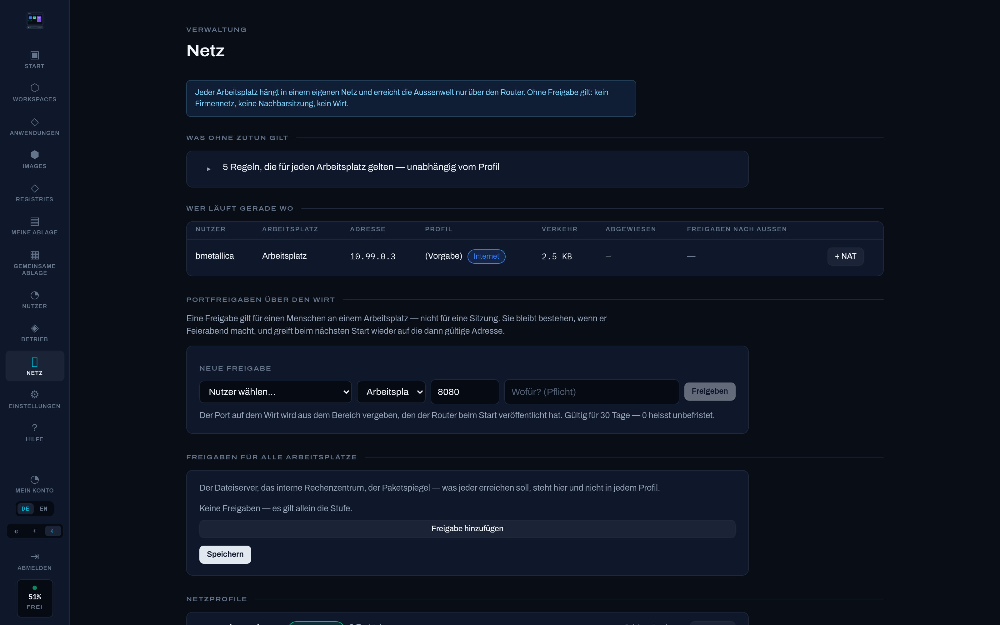

*What applies without any action is shown expanded — with reason and origin per line. Below, who is
working where right now, with throughput and dropped packets, and the button for a time-limited port
forward.*

### Where a packet ends, and why


The default. **The third line is the most important**: nothing is *dropped* towards the neighbour —
there simply is no line there. A rule can be wrong, a missing path cannot.


And the opposite direction: a port forward ("+ NAT") is the only way in from outside — through a
named port, and only as long as the time limit runs. The other three diagrams — *isolated*, *off*
and a rule by name — are in [manual, chapter 23](docs/wiki/en/23-netz.md). They are generated by
[`scripts/netzfluss.py`](scripts/netzfluss.py); whoever has turned off motion sees the same picture
with packets standing still.

**Getting software into the workspaces**
- Click packages, build the image, activate the version — with log and rollback
- **Packages are checked beforehand**: does the image know the name, and is it any use at all?
  (Ubuntu's `firefox` is just a pointer to a snap and useless in the container)
- **Recipes** for everything that is not a plain package — with a guided builder for your own
- **Find applications in the image**: OTA reads the `.desktop` files and suggests name, icon and
  start command. Nobody needs to know where a binary lives
- **The real icon from the package** — the fox, not a circle. OTA looks for it where the
  freedesktop specification puts it, scales it down to 128 pixels (VSCodium ships 428 KB) and
  serves it cacheable
- **Three shelves**: the shared one for files that should go into every workspace (read-only in
  the container), **one per user** under `/mnt/austausch` — writable, the way in and back out —,
  and **a drive per group** under `/mnt/gruppen/<name>`: the same files for a team. All three also
  in the control bar of a running session, with drag and drop. Membership decides about a group
  drive and nothing else — even an administrator only gets to the groups they belong to
- **Skeleton profile** per workspace: what a home starts with. Individual paths can be enforced on
  every start if wanted — the exception, not the rule. Plus **a subtree per application** that only
  arrives when that application starts for the first time: whoever only uses the terminal does not
  need the IDE's settings in their home
- **Freeze a session**: set things up in your own workspace, look at the preview, take it over as
  a new version. The home stays outside, secrets are flagged, the sudo exception is removed
- **Script at session start** per workspace, for everything that belongs in the home but not in
  the image
- **One-time scripts** per workspace: run exactly once per user — for a change in the home that the
  skeleton no longer reaches and that the start script would otherwise repeat on every start

**Operations**
- **Own base image** `ota/base-desktop`: Debian 13 + XFCE + **Selkies**, without applications and
  **without third-party streaming software** — H.264 over WebSockets instead of rectangular
  regions over RFB. Selkies 2.0 lives **as a fork in OTA's repository** (`third_party/selkies/`),
  so that a change upstream — like 1.6.2 disappearing on 2026-10-07 — no longer breaks the build.
  The account is called `ota` and lives under `/home/ota`; no component carries "Kasm" in its name.
  `scripts/build-desktop-image.sh --pruefen` checks 18 points against the contract with the agent
- **The older path remains** — `ota/base-xfce` (Ubuntu + KasmVNC) for Kasm images that do not bring
  Selkies. Switchable per workspace under **Streaming**; `scripts/build-base-image.sh --pruefen`
  still checks it
- **Corporate proxy** throughout: when building the services, when building the images, in every
  session and in API and agent. Even where no environment variable reaches — `apt` gets its own
  configuration. Switchable while running, without reinstalling; without a proxy there is nothing
  to do
- **Bill of materials per image** (`make sbom`) in SPDX and CycloneDX — needed as soon as an image
  leaves the building
- **Security updates with every `make update`** (fresh base and service images, the week's
  package updates) and **`make cve`**: fixable vulnerabilities per image, scanned with grype
  ([chapter 11](docs/wiki/en/11-betrieb.md#security-vulnerabilities-cves-))
- Own registry in the stack; if an image is missing locally, it is fetched from there on start
- Backup and restore of profile, container and database, manually and on a schedule
- HTTPS out of the box, own small CA, replaceable or behind a reverse proxy
- **Nothing loaded from foreign hosts.** Fonts are bundled, the interface requests nothing from the
  internet — it looks the same offline and behind a corporate proxy, and no user's IP address
  leaves the building
- **Nothing grows without limit.** Container logs are capped at 10 MB × 3 — for the services
  **and** for every workspace. In the database's audit log, behavioural data (sign-ins, sessions,
  app starts) expires after 90 days, administrative actions after 365; cleanup runs daily, and the
  cleanup itself is in the log
- **Runs next to an existing Kasm installation** on the same host, without changing anything there

## A look at administration

| | |
|---|---|
| 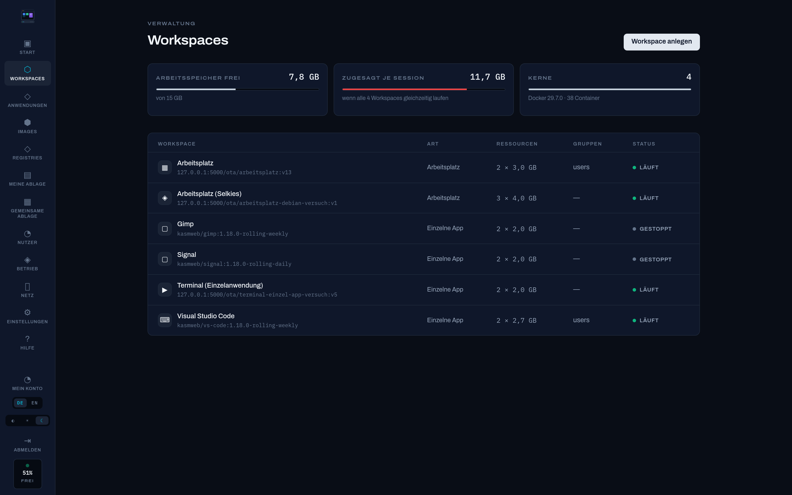 | 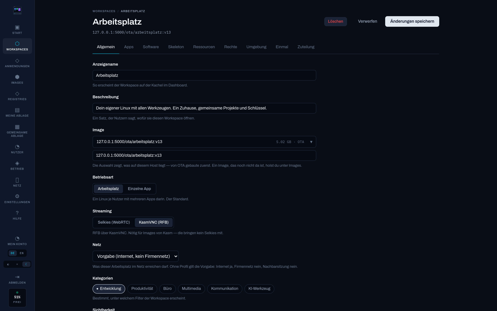 |
| **What the host can carry.** The second gauge is red: if all four templates ran at once, the machine would be overbooked. You see that beforehand, not in an OOM kill. | **The template.** One screen per workspace — image, mode, streaming path and what it may do on the network. |
| 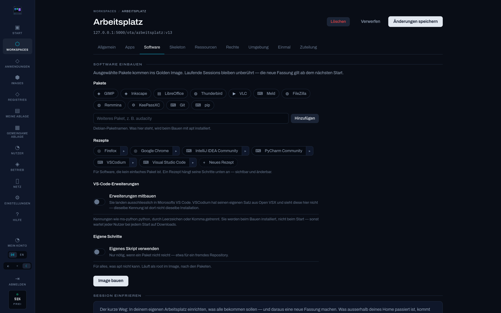 | 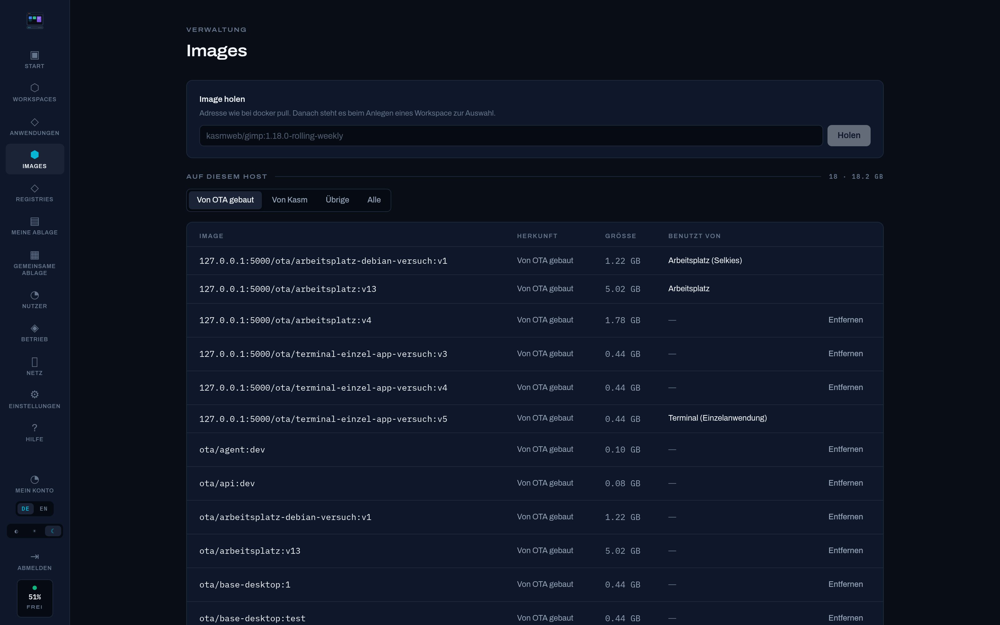 |
| **Getting software in.** Click packages or pick a recipe, then build; the log runs live. Below it the short path: freeze a session. | **The images.** What is on the host, where it came from, who uses it — and what can safely be removed. |
| 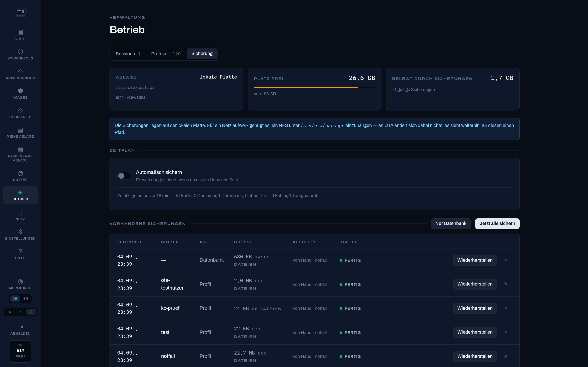 | 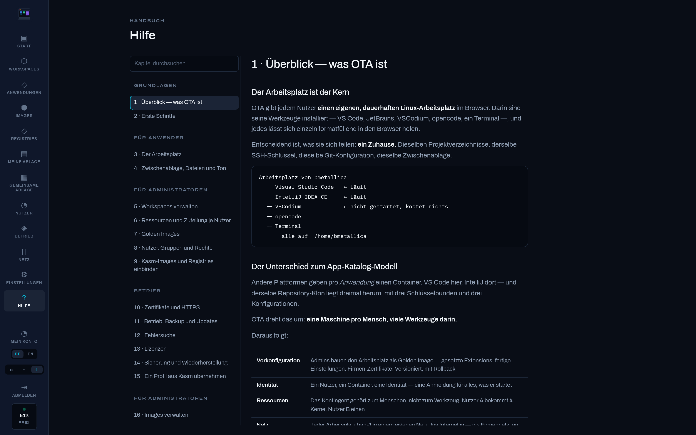 |
| **Backup.** Profiles, containers, database and content — by hand or on a schedule, with a retention rule. | **The manual lives inside the program.** Which chapters someone sees is decided by their permissions. |

The screenshots are made with `make bilder` — [`tests/screenshots.mjs`](tests/screenshots.mjs)
signs in, goes through the screens and cleans up afterwards. Two things it does **not** do: connect
to someone else's session (it starts its own) and capture screens with lists of people.

## How it is built

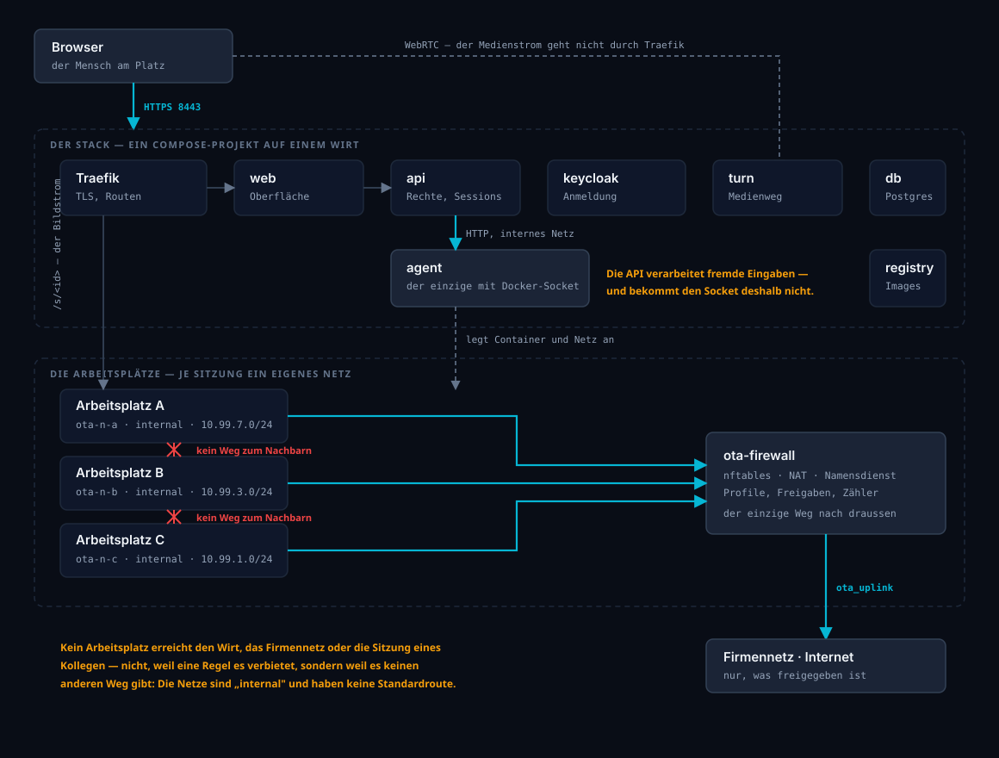

Two statements are in this picture, and both are the answer to a finding:

**Only `agent` touches Docker.** The API processes user input and therefore does not get the
socket — the same separation applies to the host's file system.

| Directory | Contents |
|---|---|
| `web/` | Interface (React, TypeScript, hand-written CSS, no UI library) |
| `api/` | REST API, sign-in, permissions, sessions (FastAPI, PostgreSQL) |
| `agent/` | The **only** service with Docker access; containers, displays, images, shelves |
| `deploy/` | Compose stack, Traefik, registry, certificates |
| `firewall/` | The router of all workspaces: nftables, NAT, name service, port forwards |
| `extension/` | Firefox extension for the clipboard |
| `docs/wiki/` | Manual — delivered inside the program as help; English in `docs/wiki/en/` |
| `images/` | Own base images: `base-desktop` (Debian + XFCE + Selkies, default) and `base-xfce` (Ubuntu + KasmVNC) |
| `tests/`, `scripts/` | Checks, certificate, migration from Kasm, bill of materials |

## Documentation

- **[Manual](docs/wiki/en/README.md)** — usage, administration, operations, troubleshooting
  (28 chapters; [German](docs/wiki/README.md))
- **[plan.md](plan.md)** — architecture **and the reasoning behind it**, including the dead ends
  (German)
- **[docs/adr/](docs/adr/README.md)** — decisions that are expensive to undo, with the alternatives
  that would not have held (German)
- **[roadmap.md](roadmap.md)** — implementation status, honestly (German)
- **[dsgvo.md](dsgvo.md)** — which personal data lives where, for how long, who sees it — and the
  four places where something is missing today (German)
- **[firewall.md](firewall.md)** — the workspaces' network protection: one network per session, a
  router in front, profiles and port forwards in the interface — including the four things that
  turned out differently than planned while building (German)

A note on troubleshooting: [chapter 12](docs/wiki/en/12-fehlersuche.md) describes real failures
from operation with symptom, cause and fix — including several that looked like something else
for days.

## Checks

```bash
make test
```

**452 checks in seven suites**, each one establishes its own starting state:

| Suite | Checks |
|---|---|
| `test-authz.sh` | A normal user can provably do nothing administrative and cannot sit at anyone else's screen; plus container hardening, metrics, quotas and second factor |
| `test-ressourcen.sh` | Changed CPU and RAM reach existing containers, running and paused; RAM below current usage waits until the next start, CPU does not; cores are a weight, a one-core container uses more on an idle host; live utilisation sees that load |
| `test-software.sh` | Software monitoring: the inventory reads a running workspace (Debian packages like `apt-mark showmanual`, start entries system-wide and in the home, hidden ones not); after filling the whitelist no alert; a new application is reported with its user; uninstalled or approved, the alert disappears, revoked it comes back |
| `test-git.sh` | OTA Git: switching on and off (data stays), subdomain behind Traefik with the OTA CA, OTA untouched, workspace entrances not on the host; sign-in through Keycloak only for entitled groups, a pre-created account is linked, admins are admins, locked instead of deleted; in the workspace clone/push without password, your own .gitconfig wins, a foreign server gets nothing, SSH via 2222, token revoked at the end, root workspace with a new token after resuming; a different subdomain; nginx as reverse proxy; backup including repositories |
| `test-root-arbeitsplatz.sh` (addition) | A run-once script assigned to a paused root workspace runs on resume as 1000 and shows up with exit code and output under "Show runs" |
| `test-gemeinsame-daten.sh` | Shared data: two root workspaces of the same account run at once, each with its own home; data folders (nested too) are the same in both and in the shared home on the host, owner 1000; settings kept apart; folders with `..`, hidden ones and an unknown persistence are refused; packages reach the root container despite a refused `put_archive`; a vanished container is paused instead of staying "running" and restarts with the same data |
| `test-duplizieren.sh` | Duplicating: settings, apps with their start command, run-once script, per-user allocation, groups and skeleton (also per application, owner 1000) are copied; own slug, disabled, source untouched; only with management rights; a shared image counts as used elsewhere. Own name: applies to that user only, template and admin untouched, too long refused, not for invisible templates, empty resets, goes with the template |
| `test-news.sh` | News: everyone reads, writing only with `settings.manage`; draft invisible and not new; publishing counts for the sidebar, opening resets, a correction does not count again; pinned on top; text stored unchanged; create, change, delete in the log |
| `test-ide-ai.sh` | IDE-AI: fetch models from the AI server, wrong input refused, API key stays on the server, test question; packages in the package source, only the agent gets the file; in every template with an editor config.yaml with mark, context window and response length, telemetry off, Continue linked in VS Code/VSCodium and JetBrains, firewall lets the AI server through, a question from the workspace gets an answer, own config.yaml stays; turned off, everything is gone again |
| `test-konten.sh` | Central sign-in accounts: creating in OTA creates in Keycloak (including the required password change), locally it does not get in; changes, password, second factor, locking and deleting take effect in Keycloak; My account goes through Keycloak; a local legacy account moves over with its password, the emergency account does not |
| `test-clipboard-bridge.sh` | Copying between two applications in the same workspace: both directions, umlauts, an image, a megabyte, after a pause, and switched off |
| `test-i18n` (`scripts/i18n-pruefen.py`) | Bilingual: every interface text and every server message has an English entry, no German text bypasses the translation, and every manual chapter exists in English with the same structure |
| `tests/e2e.mjs` | The interface in a real browser — up to the question of whether the stream really connects |
| `test-verzeichnis.sh` | Groups from the directory: both LDAP group forms are recognised, a linked OTA group gets its members at sign-in and on sync, members added by hand stay, an LDAP group "admins" makes nobody an admin, accounts without a group get the note; an application only lets its groups in, via the form **and** the SSO session, without a group nobody; whoever is missing from the directory is disabled |
| `test-verknuepfen.sh` | Linking a domain account to an existing account: afterwards only the old account exists, with the same ID, session and home, under the name from the directory; the account from the first domain sign-in is gone; the old password and the old Keycloak account no longer work; the emergency account cannot be linked; for accounts from Keycloak and for local legacy accounts |
| `test-ldap.sh` | Directory connection **through Keycloak** against a real OpenLDAP in a container — above all that a directory entry does not take over a local account and an outage does not take the emergency access down with it |
| `test-streaming.sh` | The media path with its own template on the current base image: a browser in a foreign network counts the **decoded frames** — on the desktop and on an application's display (Selkies 2.0, WebSockets through Traefik); umlauts, Shift and AltGr of a German keyboard arrive correctly. If TURN is set up (only for golden images with Selkies 1.6.2), it is checked too, including the block list and NAT |
| `test-firewall.sh` | The network protection, **measured from inside**: neighbour, host, company network, TURN, name service, internet per level, rule by name, port forward — and everything again after a restart of the router |
| `test-root-arbeitsplatz.sh` | The root workspace: root unprivileged on the host (Sysbox), Docker and Compose in the container, network rules for the **inner** containers too, stop and resume with preserved state, rebuild, web terminal with log and export, no terminal into the stack's services, golden images with `USER 1000`. Skipped without Sysbox |
| `test-repo.sh` | The own package repository: signature, upload (duplicate 409, broken 422), snapshots including protection against deletion, a Debian 13 workspace installs its own package **from here**, "mirror only" no longer calls `deb.debian.org`, the image builder adds and removes the source, an Ubuntu image stays untouched, a root workspace picks up the current setting when resuming. The mirror parts only with a mirror |
| `test-selkies-paket.sh` | The package `ota-selkies`: it is in the package repository, upgrades a workspace on an old golden image with Selkies 1.6.2, the image builder upgrades a golden image, a root workspace upgrades itself when resuming and keeps what was installed in it |
| `test-backup.sh` | Backup and restore of profile, container and database. Ends sessions for it — **only its own**, and checks that explicitly |

The checks' credentials are in `deploy/.env` and not in the source; the suites read them from
there themselves, so running `make` beforehand is not needed.

Next to it is `make messung` — **not a check but a measurement**: it compares the two streaming
paths under the same load and tells you what a session costs in CPU, bandwidth and response time.
It takes a quarter of an hour and needs a quiet machine, so it does not run with `make test`.
Results and evaluation: [chapter 20](docs/wiki/en/20-selkies-versuch.md#what-it-costs--measured).

A full run takes **about half an hour**: it starts containers, freezes an image and measures in
the browser. Each suite can be started on its own (`bash scripts/test-authz.sh`).

The media path suite exists because the most expensive bugs of this project were exactly there and
no other suite would have found them: a TURN server behind a Docker bridge sending the wrong source
address; a DTLS packet shattering on a small MTU. Both looked the same in the browser — "Waiting
for stream" — and appeared in no log.

## Licence

**Apache-2.0** (see [LICENSE](LICENSE)). Chosen because OTA is infrastructure: no obligations for
the operator, an explicit patent grant, and the same choice as the most closely related open
project (Apache Guacamole).

OTA **contains** no third-party software: dependencies are fetched at build time, components are
pulled as container images at runtime. **They keep their own licences and are not relicensed by
OTA** — broken down into three levels in [THIRD-PARTY-NOTICES.md](THIRD-PARTY-NOTICES.md), briefly
in [NOTICE](NOTICE).

A workspace **image** is a combined work: OTA configuration, Selkies (MPL-2.0, **modified by
OTA**), libx264 (GPL-2.0+), XFCE, hundreds of distribution packages, the installed applications.
It is **not** "Apache-2.0".

The base image **may be redistributed** — with four obligations: offer sources for the GPL parts,
include the five Selkies patches (MPL-2.0 applies per file), leave licence texts in the image and
ship a bill of materials. Finished workspaces with Microsoft VS Code or Google Chrome, on the other
hand, may **not** — the same with VSCodium and Firefox may.

**The applications in a golden image are governed by their own licence.** For Microsoft VS Code,
operation within your own company network is explicitly allowed, passing it on to third parties is
not. Checked with original quotes in [manual, chapter 13](docs/wiki/en/13-lizenzen.md) — not legal
advice, but based on the licence text and not on memory.

"Kasm" is a trademark of Kasm Technologies. OTA is not a Kasm product and is not affiliated with
Kasm Technologies.
