<!-- Languages: Deutsch · English (here) -->
[Deutsch](README.md) · **English**

<p align="center">
  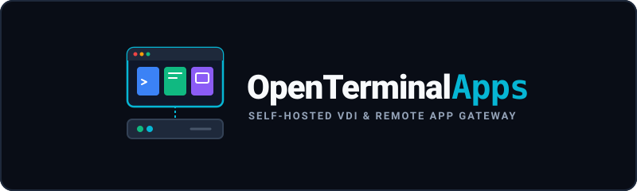
</p>

# OpenTerminalApps

A self-hosted platform that gives every user **their own Linux workspace in the browser**. Their
tools are installed in it — VS Code, VSCodium, JetBrains, Firefox, a terminal — and each one can be
streamed on its own, filling the window. They all share **one home**: the same projects, the same
SSH key, the same clipboard.

Alongside, single applications can be started as throwaway containers, and existing Kasm images as
well as whole registries can be connected — as an add-on, not as the foundation.

**Every workspace sits in its own network** behind a router: no company network, no neighbouring
session, no host — until someone explicitly allows it ([firewall.md](firewall.md)).

> **Status:** running and in use. More than twenty check suites with several hundred automated
> checks, some of them in a real browser. What is still missing is listed openly in
> [roadmap.md](roadmap.md) — none of it is glossed over.

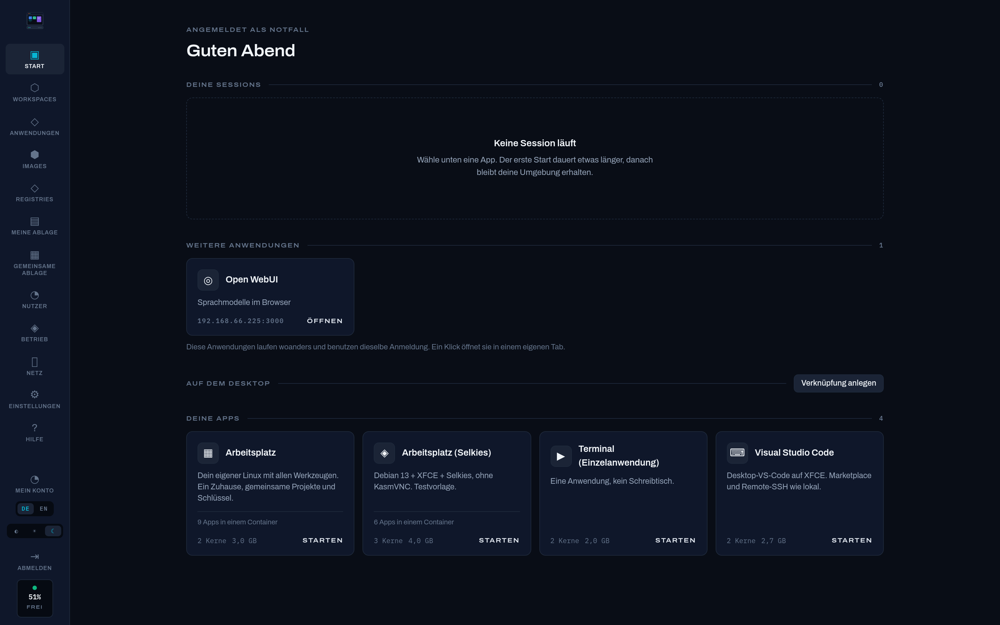

*The start page: your own running session with its applications, the cores and memory it got — and
what it may do on the network. Below, what else can be started.*

**Contents:** [Quick start](#quick-start) · [Updating](#updating) ·
[What it does](#what-it-does) — [workspace](#for-everyone-the-workspace-in-the-browser),
[root workspace](#root-workspace-root-and-docker-in-the-container),
[development](#development-git-and-ai-in-the-editor-and-the-terminal),
[AI gateway and AI usage](#ai-gateway-and-ai-usage),
[workspaces](#workspaces-and-resources), [software and images](#software-and-images),
[accounts](#accounts-sign-in-and-permissions), [network](#the-workspaces-network),
[operations](#operations-and-monitoring), [streaming](#streaming-and-base-image) ·
[A look at administration](#a-look-at-administration) · [How it is built](#how-it-is-built) ·
[Documentation](#documentation) · [Checks](#checks) · [Licence](#licence)

---

## Quick start

**Requirements** on a Linux host: `docker` with the Compose plugin (`docker compose version` must
answer), plus `git`, `make` and `openssl`. Ports **8443** and **8081** must be free — 443 is
deliberately left alone so an existing Kasm can keep running next to it. Both can be changed via
`OTA_HTTPS_PORT` and `OTA_HTTP_PORT` in `deploy/.env`.

Plus **30000–30019** as a pool for port forwards. The video stream needs **no** port of its own:
Selkies 2.0 transmits over WebSockets through the same HTTPS port as the interface. Only golden
images still built on the old base image with Selkies 1.6.2 need **3478** (TURN) and
**49160–49260/UDP**. If OTA sits behind a firewall with port forwarding, **443** is enough from the
outside — which ports go where, and what belongs in `deploy/.env` for it, is in
[chapter 24](docs/wiki/en/24-hinter-nat.md). And an address range for the workspace networks,
`10.99.0.0/16` by default — it must **not** overlap with the company network. Everything is
configurable and explained in [`deploy/.env.example`](deploy/.env.example) and
[chapter 2](docs/wiki/en/02-erste-schritte.md).

```bash
git clone https://github.com/bmetallica/openterminalapps.git
cd openterminalapps

sudo make setup                  # .env with secrets, certificate, directories
sudo make up                     # build and start the stack (a few minutes the first time)
sudo make admin NAME=yourname    # first administrator account
```

**Behind a corporate proxy**, three lines go into `deploy/.env` — `OTA_HTTP_PROXY`,
`OTA_HTTPS_PROXY` and above all `OTA_NO_PROXY`, so the services do **not** talk to each other
through the proxy. Without a proxy there is nothing to do; that is the default.
[Manual, chapter 21](docs/wiki/en/21-firmenproxy.md) also describes what OTA *cannot* solve there:
`docker pull` is done by the Docker daemon and needs its own configuration.

`make setup` **generates the secrets and fills them in itself** — nothing has to be added by hand
afterwards. Running it a second time leaves existing values untouched.

`sudo` is needed because OTA creates directories under `/srv/ota` and talks to the Docker socket.
Anyone in the `docker` group who created `/srv/ota` themselves can leave it out.

`make admin` creates **two** accounts and prints both passwords — they are shown only this once:

| Account | Where it lives | What for |
|---|---|---|
| `<yourname>` | in Keycloak | everyday access; the first sign-in immediately asks for your own password |
| `notfall` | locally in OTA | the way out if Keycloak ever does not answer |

The second one is not a gimmick: from the moment sign-in runs through another service, there has
to be a way in that works without it. It is reachable at `/notfall`, and every sign-in through it
is recorded in the audit log.

```
https://<host>:8443/            # redirects to the central sign-in
https://<host>:8443/notfall     # the local emergency access
```

**Import the root certificate once**, then the browser no longer warns — even after every later
certificate change:

```bash
sudo cp deploy/certs/ota-ca.crt /usr/local/share/ca-certificates/ota-ca.crt   # Linux, system-wide
sudo update-ca-certificates
```

In the browser: Settings → Certificates → Authorities → import `deploy/certs/ota-ca.crt`, tick
"Trust this CA to identify websites".

**Is it running?**

```bash
make ps                          # all services should be "healthy"
curl -k https://localhost:8443/healthz
```

The answer names four things: `db`, `agent`, `keycloak` and the overall state. If it says
`"keycloak":"nicht erreichbar"` (unreachable), the realm is not set up yet or the service is not up
yet — catch up with:

```bash
sudo make identity               # realm, clients, roles; idempotent
```

`make up` does that by itself and waits until Keycloak answers (about half a minute on the first
start).

If something is stuck: `make logs` and [manual, chapter 12](docs/wiki/en/12-fehlersuche.md) — it
lists real failures from operation with symptom, cause and fix.

### The first workspace

**`make up` builds the base image on the first start** — `ota/base-desktop:1`, Debian 13 + XFCE +
Selkies, without KasmVNC. That takes a few minutes and only happens if it is missing; afterwards it
is available under **Workspaces**. Rebuilding by hand works at any time:

```bash
scripts/build-desktop-image.sh --pruefen      # builds and checks the points of the contract with the agent
```

A Kasm image is **not** needed for this. Those remain possible, but they are the exception — for
ready-made catalogs and for migrating ([chapter 9](docs/wiki/en/09-kasm-images-und-registries.md)).

Then: **Workspaces → Create** — the button immediately creates a template and uses your own base
image for it, otherwise another one that looks like a desktop. In the editor assign the group
`users` and enable it, then start it under **Start** and enable the applications via **Software →
Look inside the image**. In detail in [manual, chapter 2](docs/wiki/en/02-erste-schritte.md).

## Updating

Fetch a new version from the repository:

```bash
cd openterminalapps
sudo make backup          # back up first, then change
git pull
sudo make update          # complete .env, build, start
```

From the first step on, every OTA page (dashboard, sign-in, every session) shows a banner
"**Attention!** OTA update in progress, please reload all OTA pages once this message has
disappeared." It disappears as soon as the new API is healthy; if the update fails, it stays
([chapter 11](docs/wiki/en/11-betrieb.md#the-banner-during-an-update-)).

`make update` does three things in this order, and the order is not arbitrary:

1. **Add missing settings.** If a version brings new values in `deploy/.env.example`,
   `make update` adds them with sensible defaults. **Existing values stay untouched** — including
   the secrets. If this happened only after building, a service would start against a variable
   that does not exist yet.
2. **Build and start — with security updates.** The third-party services (Postgres, Keycloak,
   Traefik …) are pulled fresh within their version line, the own images on a fresh base and with
   the week's package updates. Without network it continues with what is there. The database
   migrates by itself: Alembic when the API starts, and OTA adds missing columns from the model.
   There is no manual migration step.
3. **Say what does *not* happen by itself.** See below.

### What an update does not touch

| | Why, and what to do |
|---|---|
| **Running sessions** | They keep their image until they are ended. That is intentional: nobody should be interrupted in the middle of their work. Whoever wants the changes right away ends their workspace and starts it again. |
| **The base image** | Is not rebuilt on every update — it takes minutes, and most versions do not touch it. `make update` does **check** whether the build recipe is newer than the built image, and says so. Build with `scripts/build-desktop-image.sh --pruefen`. |
| **The workspace images** | A new base image only takes effect once the images derived from it are rebuilt — in administration under **Software**. |
| **`deploy/.env`** | Is only extended, never overwritten. Whoever wants to change a setting does it themselves; the template next to it explains every one. |

### Switching to a corporate proxy later

The same way, while running and without reinstalling: enter the three lines in `deploy/.env`,
`sudo make update`. Services and **new** sessions pick it up immediately; running ones keep their
state until their next start. The base image does **not** have to be rebuilt for this — the proxy
is never baked into the image. Switching back is the same way.

Measured in both directions; the pitfalls are in [chapter 21](docs/wiki/en/21-firmenproxy.md).

### Behind a firewall with NAT

Users come in from outside via the firewall's address, OTA sits behind it, perhaps with a reverse
proxy in front and the directory on the other side. What needs forwarding from the outside is
**443** (to the proxy, with WebSockets — since Selkies 2.0 the video stream goes through there
too); towards the outer network Keycloak needs **636** to the directory. Only as long as golden
images with Selkies 1.6.2 are running, **3478/TCP** directly to the OTA host is added, and two TURN
addresses in `deploy/.env`, the firewall's and the host's own:

```bash
OTA_TURN_HOST=10.50.0.33        # the firewall — this is how browsers see TURN
OTA_TURN_BIND=192.168.1.22      # the host — coturn binds to this
OTA_TURN_PROTOCOL=tcp
OTA_TURN_ICE_POLICY=relay
OTA_TRUSTED_PROXIES=192.168.1.23/32
```

Hairpin NAT on the firewall is not needed: the workspaces' router redirects the published address
to the host itself. The directory's CA belongs in `deploy/keycloak-truststore/`. Complete port
lists, an nginx example and the check: [chapter 24](docs/wiki/en/24-hinter-nat.md).

### Enabling root workspaces

Root and Docker inside the workspace need **Sysbox** on the host. During installation the package
wants to restart Docker and suggests deleting all containers for that — the script avoids this and
does not touch any container:

```bash
sudo scripts/sysbox-einrichten.sh --pruefen          # look at the prerequisites
sudo scripts/sysbox-einrichten.sh --live-restore     # set up
sudo make up                                         # builds ota/base-desktop-root:1
```

Then create a template of the class "Root with Docker" and grant the permission "Use root
workspace" to the groups that should get it. In detail in
[chapter 25](docs/wiki/en/25-root-arbeitsplatz.md).

### Own limits inside the workspace (LXCFS)

So that `free`, `htop` and `uptime` inside a workspace show its limits instead of the host's,
`make up` (and therefore `make update` too) sets up **LXCFS** on the host: it installs the Debian
package if it is missing and sets the required options. An LXCFS that is already running and in use
is not restarted for this. To check:

```bash
sudo scripts/lxcfs-einrichten.sh --pruefen
```

**Running workspaces only get it at their next start**, root workspaces at their next resume,
without a rebuild. Whoever does not want it sets `OTA_LXCFS=aus` in `deploy/.env`. See
[chapter 11](docs/wiki/en/11-betrieb.md#inside-the-workspace-lxcfs-and-ota-top-).

### Turning on the package mirror

The own package repository always runs — it is how `ota-selkies`, the streaming server, gets into
the workspaces. A **mirror** of Debian 13 and Docker's repository is an add-on, off by default. A
full mirror needs roughly 100 to 130 GB:

```bash
# in deploy/.env
OTA_REPO_SPIEGEL=1
OTA_REPO_ROOT=/srv/ota/repo
sudo make update
```

Then sync once under **Administration → Package sources**. In detail in
[chapter 26](docs/wiki/en/26-paketquellen.md).

### When something goes wrong

```bash
sudo make ps              # which service is not up?
sudo make logs            # what does it say?
```

`scripts/restore-db.sh` restores the backup from above. **Users' profiles** live under
`/srv/ota/profiles` and are not touched by an update — they even survive a complete rebuild of the
stack.

Going back to the previous version is `git checkout <old-state> && sudo make update`. What does
**not** go back is the database: new columns stay. They do not bother an older version, but data
that did not exist before is simply there.

## What it does

The overview follows the roles: first what every person gets in their workspace, then development
and AI, then administration, network and operations. Each point links to the manual chapter that
explains it in full.

### For everyone: the workspace in the browser

- **One container per person and template**, with every application on its own screen, started
  only when needed. The dashboard shows the running session with its applications, the cores and
  memory it got, and what it may do on the network. Below it are the tiles of all other templates
  that can be started ([chapter 3](docs/wiki/en/03-arbeitsplatz.md), [29](docs/wiki/en/29-los-gehts.md))
- **Every application in its own browser tab**, with its own address, and installable as a desktop
  shortcut (PWA). The classic XFCE desktop is available as an additional view
- **The remote screen grows with the window**, with no black border and no scaling. The session's
  control bar handles screen, keyboard, sound and the shelves. Umlauts, Shift and AltGr of a German
  keyboard arrive correctly, and sound plays in the browser
  ([chapter 34](docs/wiki/en/34-bedienung.md))
- **Clipboard in both directions**, images included, and also between two applications in the same
  container ([chapter 4](docs/wiki/en/04-zwischenablage.md))
- **One home for all applications**: the same projects, the same SSH key, the same settings. It
  outlives every container: when OTA "deletes" something, it is the container, not the home. The
  only exception is templates that are explicitly set to *ephemeral*
  ([chapter 31](docs/wiki/en/31-dateien.md))
- **Three shelves**:
  - the shared one for files that should go into every workspace (read-only in the container);
  - **one per person** under `/mnt/austausch`, writable, the way in and back out;
  - **a drive per group** under `/mnt/gruppen/<name>` with the same files for a team.

  All three are also in the control bar of a running session, with drag and drop. Group membership
  alone decides access to a group drive; an administrator too only reaches the groups they are in
  themselves ([chapter 17](docs/wiki/en/17-ablage-und-startskript.md))
- **Seeing your own load**: through LXCFS, `free`, `htop` and `uptime` show the memory, cores, load
  and uptime **of your own workspace**, not those of the host. For the CPU there is **`ota-top`**.
  It reads the cgroup and shows:
  - usage, allotted cores and the upper limit;
  - whether the workspace is being throttled right now and whether memory ran full;
  - how long programs waited for CPU, memory or disk;
  - the programs using the most CPU.

  See [chapter 33](docs/wiki/en/33-entwickeln.md#how-busy-is-my-workspace-).
- **Rename tiles for yourself**, without changing anything for anyone else. The **⋯** menu on the
  tile sets up the AI tools again, rebuilds a root workspace and opens the views of extensions
- **My account**: change the password and set up a second factor, as a passkey or as a one-time
  password, with recovery codes. For directory accounts this happens in the directory
  ([chapter 30](docs/wiki/en/30-mein-konto.md))
- **News** from administration, with a dot in the sidebar for unread posts. **My AI usage** shows
  your own figures, and the **GDPR** item explains what is recorded
- **The manual inside the program**, in German and English and filtered by permissions. It has its
  own chapters for users: first steps, account, files, root workspace, Git and AI, operation, help
  with problems, and terms ([chapters 29 to 36](docs/wiki/en/29-los-gehts.md))
- **German or English, dark or light** (or whatever the computer is set to), switchable at the top
  right, even before signing in
- **Whoever watches is in the log.** Only a full administrator can connect to a running session, a
  supporter cannot. Every connection is logged with both names and kept for a year
  ([chapter 3](docs/wiki/en/03-arbeitsplatz.md#who-else-can-see-your-screen))
- **Signed out after inactivity, not after time.** The rolling limit can be set from 30 minutes to
  48 hours: whoever is working is not signed out, and brief API outages no longer throw anyone out.
  Idle workspaces are paused, stopped or deleted per template; the home is always kept

### Root workspace: root and Docker in the container

- **root, Docker and `docker compose` in the container**, under Sysbox and therefore without
  `--privileged`: root in the container is unprivileged on the host
  ([chapter 25](docs/wiki/en/25-root-arbeitsplatz.md), for users
  [chapter 32](docs/wiki/en/32-root-arbeitsplatz-nutzen.md))
- **Ending pauses instead of deleting.** Whatever was installed stays, Docker images and containers
  included, and the workspace keeps its fixed address. **Rebuild** fetches a new base image
- **The same network rules for the inner containers.** They go through the same router. Their
  networks come from a fixed range (`OTA_ROOT_DOCKER_NETZE`) and do not cover the LAN
- **Fast resume**: a progress bar on the tile shows the current step. Resuming does not wait for the
  disk measurement or the inner containers. OTA removes stale PID files of dockerd and containerd at
  start
- **Process limit 32768** instead of 4096, adjustable via `OTA_ROOT_PIDS_LIMIT`, so Compose stacks
  and builds do not hit the limit
- **Several at once**: with the persistence *Shared data*, two root workspaces of one person run
  side by side. Each has its own settings, while `Desktop`, `Documents` and the like come from the
  shared home
- **Two dedicated permissions**: *Use root workspace* and *Web terminal as root into running
  workspaces*. Every input in the web terminal is logged with a name and can be exported
  ([chapter 8](docs/wiki/en/08-nutzer-und-gruppen.md#two-permissions-for-root-workspaces-))
- **Upgrades itself on resume**: new Selkies, IDE AI, opencode, Git token, package source, LXCFS,
  one-time scripts and `ota-top`. A root workspace does not need a rebuild for this

### Development: Git and AI in the editor and the terminal

- **OTA Git (Forgejo)**, switchable on and off in the menu ([chapter 27](docs/wiki/en/27-git.md)):
  - Runs under its own subdomain behind the same entrance as OTA.
  - Sign-in with the OTA credentials through Keycloak, only for authorised groups.
  - OTA creates the accounts and disables them instead of deleting them. OTA admins are admins
    there too.
  - Workspaces and root workspaces get Git preconfigured: a token per workspace, revoked at the
    end; SSH only inside the container network. Other Git servers stay untouched, and a personal
    `.gitconfig` takes precedence.
- **IDE AI**, switchable on and off under Settings: an AI assistant (Continue) in VS Code, VSCodium
  and PyCharm/IntelliJ, connected to your own AI server. That can be vLLM, llama.cpp or any other
  server with an OpenAI interface ([chapter 28](docs/wiki/en/28-ide-ai.md)):
  - Models as a selection list, each with context window and answer length; plus tools (agent
    mode), temperature, timeout, rules and authorised groups.
  - The packages come from the own package source into every workspace with a matching editor,
    also in Ubuntu and Kasm images.
  - Continue sits on the right in the sidebar, Copilot is off, and so is Continue's telemetry.
  - The firewall lets the AI server through while IDE AI is on.
  - If a marketplace update or a personal configuration has pushed Continue aside, **⋯ → Set up AI
    tools again** restores OTA's version.
- **opencode**, switchable on and off under Settings: the AI assistant in the terminal, with the AI
  server and the models from IDE AI ([chapter 38](docs/wiki/en/38-opencode.md)):
  - The package comes from the own package source in the pinned version. A self-installed opencode
    is taken over; the original stays as `*.vor-ota`.
  - OTA writes opencode's managed configuration to `/etc/opencode/`. Personal settings in
    `~/.config/opencode` are added, and a personal default model stays.
  - An addition to the system prompt, global and per group, with preview and audit log.
  - Further MCP servers, remote or local, with API key, each released for groups.
- **Extensions**: standalone Docker applications with their own Compose project. They are coupled
  to OTA through a contract and can be switched on for groups
  ([chapter 39](docs/wiki/en/39-erweiterungen.md)):
  - Every workspace gets its own token; MCP servers and prompt snippets go to opencode.
  - No host port and no firewall rule. Account deletion, disabling and backup are handled too.
  - The first one is the **memory for opencode**
    ([plugin_ota-opencode](https://github.com/bmetallica/plugin_ota-opencode)): every opencode
    session gets its own long-term memory, with embeddings from vLLM or llama.cpp. The sidebar item
    **opencode · Memories** offers:
    - each session's entries for reading, editing, pinning, copying and moving;
    - read access for one session to another session's memory;
    - a **main memory** that all sessions of a person read along;
    - a **document library** (PDF, Office, text) that opencode searches with source references.
      Credentials in the text are removed during extraction.

### AI gateway and AI usage

- **Several AI servers under one name.** The first server applies to everyone, every further one
  is added for its **groups**. Continue and opencode see one shared model directory across all
  servers ([chapter 28](docs/wiki/en/28-ide-ai.md#several-ai-servers-ai-gateway-and-usage-statistics))
- **AI gateway** (`ota-ki`, optional): workspaces talk to `ki.ota`. The AI server's key stays out
  of the homes, and the firewall also intercepts connections that scripts send directly to a
  server's real address. If the gateway goes down, traffic goes direct again by itself. HTTPS to
  the AI server is spoken with certificate verification. Direct HTTPS connections from a script are
  passed through unread and only counted as a connection
- **External services such as Open WebUI** can also talk to the AI through the gateway if wanted.
  They get their own key and are subject to the same group rule and the same statistics. Requests
  are attributed per person through Open WebUI's headers
- **AI usage under Operations** (optional, off by default). **Only real model calls** are counted;
  requests such as `/v1/models`, `/health` or monitoring services' login pages stay out:
  - **Without names**: totals, history and a distribution by time of day. Plus ring charts per
    template, model, server and **application**, and per person and workspace only by rank and
    only from three upwards.
  - **Filters** by source (all, OTA only, Open WebUI only), model and application. If fewer than
    three people are in the selection, the page shows no figures.
  - **Recognised applications**: opencode, Continue, Cline, Roo Code, Kilo Code, Aider and
    Copilot. Plus VS Code and the JetBrains IDEs, which OTA derives from the template, and Open
    WebUI. For scripts the statistics name the language: Java, Node or Python.
  - **Names and individual histories** only after a **justification** that is logged with a name,
    and only for 30 minutes.
  - Everyone sees their own figures under **My AI usage**. A **GDPR** item in the sidebar informs
    everyone; administration can adjust its text.
  - Contents are never recorded, and retention is adjustable.

### Workspaces and resources

- **A template's editor**: image, mode, streaming path, network, apps, resources, permissions,
  environment and allocation, all on one screen. The **capacity display** shows in advance whether
  the host would be overbooked, instead of finding out from an OOM kill
  ([chapter 5](docs/wiki/en/05-workspaces-verwalten.md))
- **Resources per person and workspace**: A gets 2 cores, B one
  ([chapter 6](docs/wiki/en/06-ressourcen-und-zuteilung.md)). Changed CPU and RAM values also reach
  existing containers, running and paused
- **Cores as a weight, not a cap.** When the host is free, a workspace may use up to four times
  its share; when it is full, the kernel divides proportionally. So nothing stutters any more while
  the host is half empty
- **Duplicate workspaces**, with apps, one-time scripts, allocations, groups and skeleton. A fully
  set-up root workspace, for example, becomes the template for the next one
  ([chapter 5](docs/wiki/en/05-workspaces-verwalten.md#duplicating-))
- **Persistence** per template: *Per user* (one home for all workspaces, the normal case), *Per
  workspace*, *Ephemeral* or *Shared data*. With shared data several workspaces run at the same
  time, each with its own settings and the same data folders
- **A quota per home and a lower limit for free disk space.** Whoever reaches the limit gets an
  understandable refusal, instead of a container that freezes mid-work while writing.
  - **Core dumps** of crashed programs (`core.<pid>`) no longer fill any home. New containers do
    not create them, and whatever still appears in existing ones OTA removes before every
    measurement and daily ([chapter 11](docs/wiki/en/11-betrieb.md#ota-cleans-up-core-dumps-itself-)).
  - The **disk measurement** runs one at a time in the background, at most once an hour per
    workspace (`OTA_PLATZ_MESSEN_MINUTEN`), and when a root workspace is paused.
- **Clipboard per workspace and group**: paste, copy, images and the selection clipboard can be
  switched individually. Groups can be stricter than the workspace, never more generous
  ([chapter 37](docs/wiki/en/37-zwischenablage-verwaltung.md))
- **Skeleton profile** per workspace: what a home starts with, including `.bashrc`, `.profile` and
  `.bash_logout`. Individual paths can be enforced at every start if wanted; that is the exception,
  not the rule. Plus **a subtree per application** that only arrives when that application starts
  for the first time ([chapter 17](docs/wiki/en/17-ablage-und-startskript.md))
- **Script at session start** per workspace, for everything that belongs in the home but not in
  the image, such as a company certificate
- **One-time scripts** per workspace run exactly once per person, also when root workspaces are
  resumed. They are meant for changes in the home that the skeleton no longer reaches. **Show
  runs** shows return code and output

### Software and images

- **Click packages, build the image, activate the version**, with log and rollback
  ([chapter 7](docs/wiki/en/07-golden-images.md))
- **Packages are checked beforehand**: does the image know the name, and is the package any use at
  all? Ubuntu's `firefox`, for example, is only a pointer to a snap and useless in a container
- **Recipes** for everything that is not a simple package, with a guided builder for your own
- **Freeze a session**: set things up in your own workspace, look at the preview and take it over
  as a new version. The home stays out, secrets are flagged, the sudo exception is removed
- **Find applications in the image**: OTA reads the `.desktop` files and suggests name, icon and
  start command. Nobody needs to know where a binary lives
- **The real icon from the package**, the fox rather than a circle. OTA looks for it where the
  freedesktop specification puts it, scales it down to 128 pixels (VSCodium ships 428 KB) and
  serves it cacheable
- **Visibility per application and group**, for when a licence does not cover everyone, and a
  **resolution per application**
- **Manage images**: what is on the host, where it came from and who uses it, and what can be
  removed safely. There is also a registry of its own in the stack; if an image is missing
  locally, it is fetched from there at start ([chapter 16](docs/wiki/en/16-images-verwalten.md))
- **Include Kasm images and whole registries**, as an addition and for switching over. There is a
  catalogue with suggested versions and checks before taking anything over
  ([chapter 9](docs/wiki/en/09-kasm-images-und-registries.md)). A **profile from Kasm** can be
  taken over (`scripts/migrate-kasm-profile.sh`, [chapter 15](docs/wiki/en/15-migration-aus-kasm.md))
- **Own package source** (always on) ([chapter 26](docs/wiki/en/26-paketquellen.md)):
  - **your own `.deb` packages** by drag and drop;
  - **pinned snapshots** with rollback and reproducible images;
  - the packages **`ota-selkies`**, `ota-ide-ai` and `ota-opencode`, which bring the streaming
    server and the AI tools into images and upgrade root workspaces on resume.

  A **mirror** of Debian 13 including security updates and Docker's repository is an add-on, off
  by default. With it, workspaces install even when something outside is missing: in the mode
  "mirror first" or "mirror only". Syncing is manual; the mirror's age turns yellow and red.
- **Software monitoring**: every hour OTA records which applications are installed in each
  running workspace (apt, start menu, Flatpak, Snap), without versions. There is a whitelist that
  can be filled from the current state. Whatever is not on it, administrators see on the dashboard
  and approve with one click. Once it is uninstalled, the alert disappears by itself
  ([chapter 11](docs/wiki/en/11-betrieb.md#software-monitoring-))

### Accounts, sign-in and permissions

- **Central sign-in through Keycloak**, shipped in the stack, or connect an existing Keycloak. OTA
  manages it: accounts, groups and the **AD connection** are set up in OTA's interface, and the
  Keycloak console stays closed for everyday use. **It is still reachable** (`/auth/admin/`), on
  purpose: whoever walls it up locks themselves out when something breaks
  ([chapter 18](docs/wiki/en/18-zentrale-anmeldung.md))
- **One entrance for everyone.** An account created in OTA comes into being in Keycloak, with the
  password administration assigns. Old local accounts move over **with their password** at the
  next sign-in; only the emergency account stays local. The sign-in page follows OTA's brand,
  language and theme
- **Emergency access** under `/notfall`: a local account that works without Keycloak. In front of
  it sits a brake (ten attempts per minute and sender). The lockout after failed attempts applies
  per **(account, sender)**, so it cannot be turned against a colleague
- **Two-factor enforceable per group**, with a **passkey** (fingerprint, face, security key) or a
  one-time password. The passkey is offered, not required
- **Groups from the directory** (OpenLDAP or AD): an OTA group takes its members from LDAP groups,
  in addition to those added by hand. This applies immediately at sign-in and through a sync at an
  adjustable interval (15 minutes to 1 day) or at the push of a button. Whoever is missing from
  the directory is disabled, never deleted. Accounts without a group see an empty dashboard with a
  note ([chapter 8](docs/wiki/en/08-nutzer-und-gruppen.md#active-directory-and-ldap-))
- **A directory entry never takes over an existing account by itself**, not even with the same
  name. Administration can, however, **assign a domain account to an existing account**. After
  that the old account signs in through the directory and keeps its container, home and shelves
- **Roles and permissions** per group, enforced in the API. Administrators are `root` in their own
  container. Accounts are disabled instead of deleted, and every administrative action is in the
  audit log
- **Third-party web applications** in the catalogue (Open WebUI, Grafana, …): OTA creates the OIDC
  access and decides who sees the tile **and who may sign in there**:
  - Keycloak checks this itself, even when the address is called directly; without a group nobody
    gets in.
  - The OTA groups are in the token, so the application can hang something on them, such as an
    MCP server in Open WebUI.
  - A sign-in lasts equally long for OTA and the applications.
  - What someone may do inside the application is up to the application; OTA does not rebuild its
    permission model.

### The workspaces' network

- **Its own network per workspace** ([chapter 23](docs/wiki/en/23-netz.md)), all ending in one router. No company network, no
  neighbouring session, no host — and not because a rule forbids it, but because there is no other
  path: the networks are `internal`, Docker sets up neither NAT nor a default route there
- **The base rule set is visible in the interface** — what OTA opens for itself (TURN, its own
  address, name service, proxy, time server), each line with destination, ports, **reason and
  origin**. Derived from `.env`, so it can be seen but not changed
- **Profiles per template** in three levels: *isolated* (only what OTA needs), *internet* (the
  default) and *off* — the last one lifts everything, requires a justification and is recorded in
  the audit log
- **Rules by address, range or name**, global for everyone or per profile. Names work because the
  router is also the name service: what it answers it enters into the rule itself — rule and
  connection come from the same lookup
- **"+ NAT"**: publish a workspace port through the host for a limited time, for whoever wants to
  demo their own application. The expiry is enforced, not just displayed
- **Fixed addresses** per person and template — after hours and after a restart too. Without that
  an upstream firewall could not be configured for a workspace
- **Overview with throughput and dropped packets** per workspace. A port scan looks exactly like
  what it is in this number

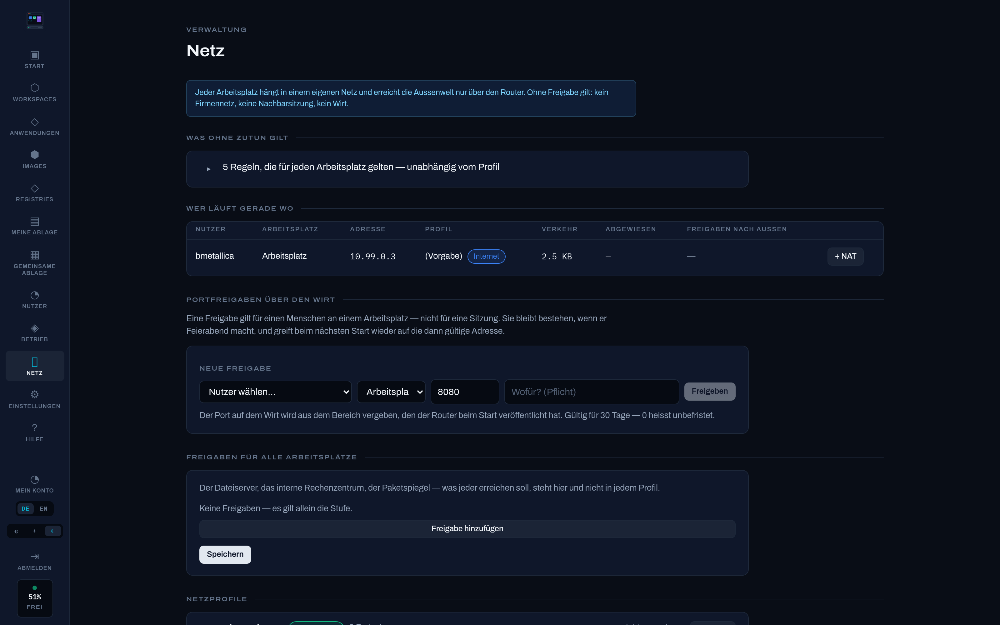

*What applies without any action is shown expanded — with reason and origin per line. Below, who is
working where right now, with throughput and dropped packets, and the button for a time-limited port
forward.*

#### Where a packet ends, and why


The default. **The third line is the most important**: nothing is *dropped* towards the neighbour —
there simply is no line there. A rule can be wrong, a missing path cannot.


And the opposite direction: a port forward ("+ NAT") is the only way in from outside — through a
named port, and only as long as the time limit runs. The other three diagrams — *isolated*, *off*
and a rule by name — are in [manual, chapter 23](docs/wiki/en/23-netz.md). They are generated by
[`scripts/netzfluss.py`](scripts/netzfluss.py); whoever has turned off motion sees the same picture
with packets standing still.

### Operations and monitoring

- **Live utilisation** under **Operations → Workspaces**: bars for CPU, RAM and network per
  workspace and for the host. A warning appears as soon as the CPU limit throttles a container.
  The same list shows every workspace of every user, running and paused, with disk space and "last
  active". From there they can be started, paused and deleted, or the **root web terminal** opened
  ([chapter 11](docs/wiki/en/11-betrieb.md#live-utilisation-operations--workspaces-))
- **LXCFS** is set up on the host by `make up` itself. New workspaces get it through Docker,
  existing ones at their next start or resume; this applies to root workspaces under Sysbox too.
  With `OTA_LXCFS=aus` it stays off
  ([chapter 11](docs/wiki/en/11-betrieb.md#inside-the-workspace-lxcfs-and-ota-top-))
- **Progress bar and start log**: the tile shows what is happening during start right now. The
  agent's log has one line per start with the duration of each step
  ([chapter 25](docs/wiki/en/25-root-arbeitsplatz.md#start-time))
- **`/healthz` and `/metrics`** for external monitoring
- **Logs**: **Operations → Log** has sign-ins, sessions, administrative actions,
  screen connections and disclosures. Behavioural data expires after 90 days, administrative
  actions after 365. Cleanup runs daily, and the cleanup itself is logged
- **Nothing grows without a limit.** Container logs are capped at 10 MB × 3, for the services
  **and** for every workspace
- **Backup and restore** of profile, container and database, root workspaces and OTA Git
  included, by hand and on a schedule, with a retention rule
  ([chapter 14](docs/wiki/en/14-sicherung.md))
- **Updates in one step** (`make update`), see [Updating](#updating). During the update every OTA
  page shows a banner. On top of that come the **security updates** with every `make update`: fresh
  base and service images, the week's package updates, and a new Forgejo version is picked up by
  OTA Git by itself. **`make cve`** lists the fixable vulnerabilities per image, scanned with grype
  ([chapter 11](docs/wiki/en/11-betrieb.md#security-vulnerabilities-cves-))
- **A bill of materials per image** (`make sbom`) in SPDX and CycloneDX. It is needed as soon as an
  image leaves the house
- **Corporate proxy** throughout: when building the services and the images, in every session, in
  API, agent and package source. Even where no environment variable suffices, `apt` for example
  gets its own configuration. Switchable during operation, without reinstalling
  ([chapter 21](docs/wiki/en/21-firmenproxy.md))
- **HTTPS out of the box** with its own small CA, replaceable, or behind a further reverse proxy
  (nginx, Caddy …). OTA also runs **behind a firewall with NAT**, without hairpin NAT
  ([chapter 10](docs/wiki/en/10-zertifikate-und-https.md), [24](docs/wiki/en/24-hinter-nat.md))
- **Data locations**: databases, registry, OTA Git and the Docker data of the root workspaces can
  be put on a disk of their own via `.env`, such as an SSD; the user data stays on the large one.
  `scripts/daten-umziehen.sh` moves the data during operation and switches over in seconds. Running
  root workspaces are never paused but switched over at their next resume. If `/srv/ota` with the
  user data sits on the system disk, `scripts/srv-umziehen.sh` moves it to the big disk as a whole;
  a bind mount keeps the path the same
  ([chapter 40](docs/wiki/en/40-datenorte.md))
- **Your own brand**: installation name, accent colour and logo. They appear in the browser tab, on
  the sign-in page (Keycloak's too), on the start screen and in the PWA
  ([chapter 22](docs/wiki/en/22-marke.md))
- **Writing news**: posts from administration to everyone, written directly on the page in
  Markdown with line breaks and filtered HTML. There are drafts, pinning and a dot in the sidebar
  for unread posts ([chapter 11](docs/wiki/en/11-betrieb.md#news-))
- **Default language** for everyone who does not switch themselves. It also applies to Keycloak's
  sign-in page and the manual
- **Diagnostic scripts** for the cases that look like something other than what they are:
  - `docker-diagnose.sh` explains why Docker is slow on the host;
  - `platten-last.sh` shows who is loading the disk;
  - `platz-diagnose.sh` finds out why a workspace has no network.

  [Chapter 12](docs/wiki/en/12-fehlersuche.md) describes real failures with symptom, cause and fix.
- **No loading from third-party hosts.** The fonts are bundled, and the interface requests nothing
  from the internet. It looks the same offline and behind a corporate proxy, and no user's IP
  address leaves the house
- **Runs next to an existing Kasm installation** on the same host, without changing anything there

### Streaming and base image

- **Own base image** `ota/base-desktop`: Debian 13 + XFCE + **Selkies**, without applications and
  **without third-party streaming software**. It transmits H.264 over WebSockets through the same
  HTTPS port as the interface, instead of rectangular tiles over RFB. The account is called `ota`
  and lives under `/home/ota`; no component carries "Kasm" in its name.
  `scripts/build-desktop-image.sh --pruefen` checks the points of the contract with the agent
  ([chapter 19](docs/wiki/en/19-eigenes-basisimage.md))
- **Selkies 2.0 as a fork in OTA's repository** (`third_party/selkies/`). So a change upstream no
  longer breaks the build, as happened when 1.6.2 disappeared on 2026-10-07. As the package
  `ota-selkies` it also upgrades older golden images ([chapter 20](docs/wiki/en/20-selkies-versuch.md))
- **`ota/base-desktop-root`** for root workspaces (`make root-image`)
- **The older path remains**: `ota/base-xfce` (Ubuntu + KasmVNC) for Kasm images that do not bring
  Selkies. Switchable per workspace under **Streaming**; `scripts/build-base-image.sh --pruefen`
  still checks it
- **`make messung`** compares the two streaming paths under the same load: CPU, bandwidth and
  response time per session

## A look at administration

| | |
|---|---|
| 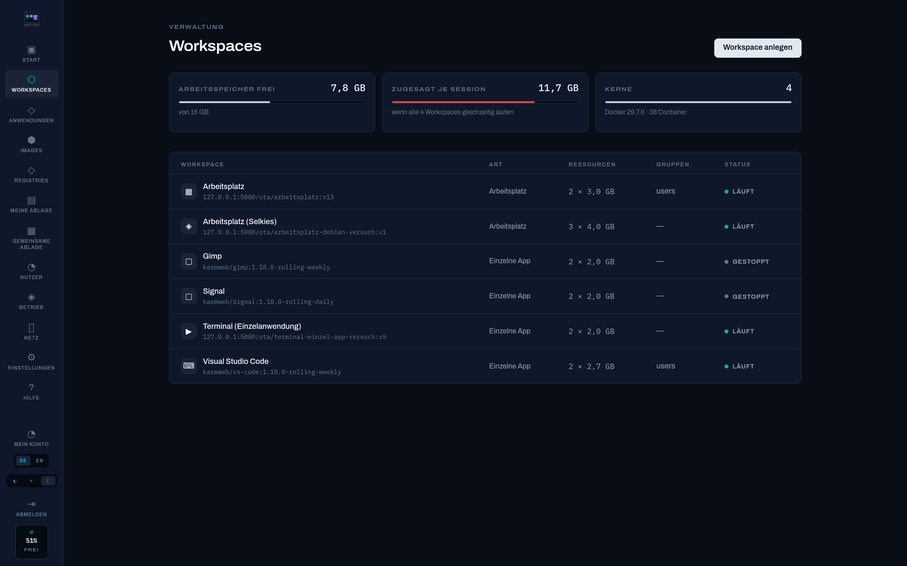 | 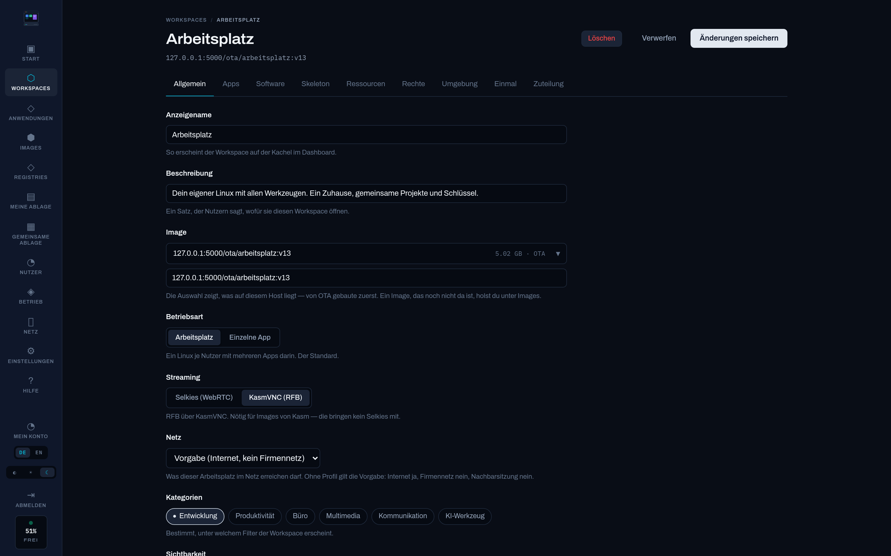 |
| **What the host can carry.** The second gauge is red: if all four templates ran at once, the machine would be overbooked. You see that beforehand, not in an OOM kill. | **The template.** One screen per workspace — image, mode, streaming path and what it may do on the network. |
| 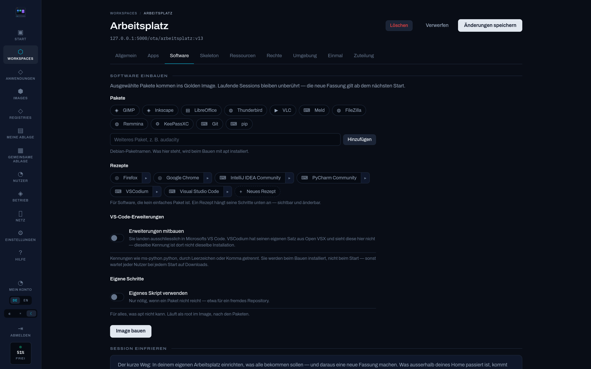 | 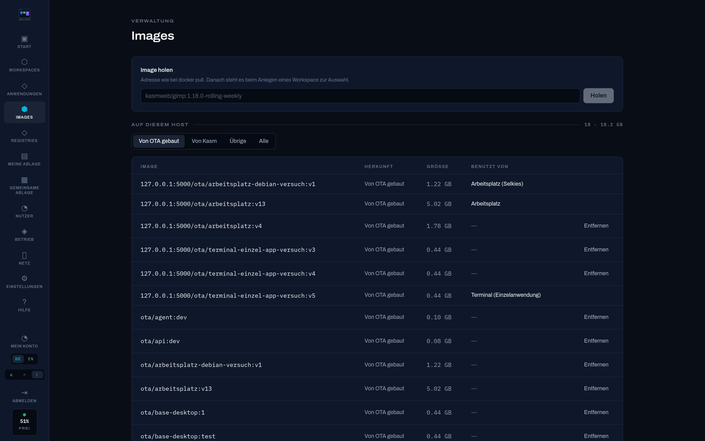 |
| **Getting software in.** Click packages or pick a recipe, then build; the log runs live. Below it the short path: freeze a session. | **The images.** What is on the host, where it came from, who uses it — and what can safely be removed. |
| 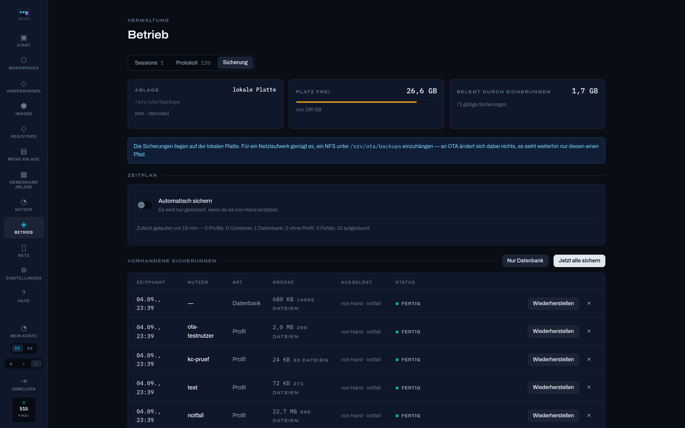 | 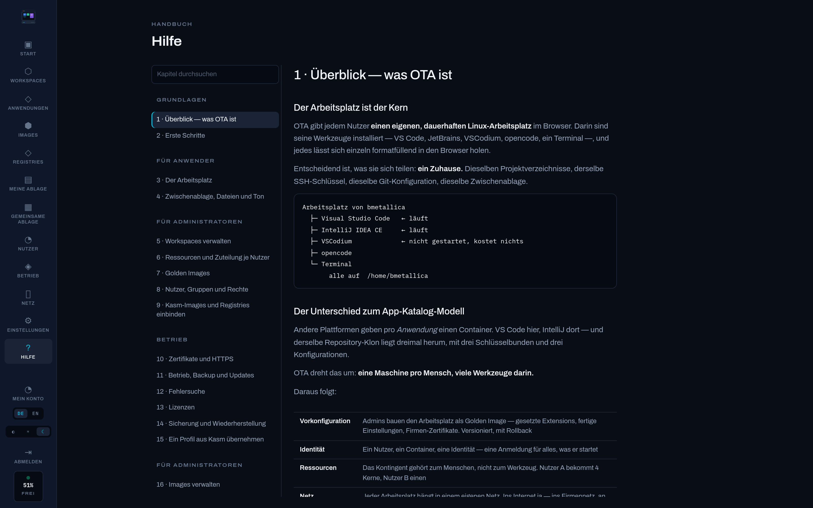 |
| **Backup.** Profiles, containers, database and content — by hand or on a schedule, with a retention rule. | **The manual lives inside the program.** Which chapters someone sees is decided by their permissions. |

The screenshots are made with `make bilder` — [`tests/screenshots.mjs`](tests/screenshots.mjs)
signs in, goes through the screens and cleans up afterwards. Two things it does **not** do: connect
to someone else's session (it starts its own) and capture screens with lists of people.

## How it is built

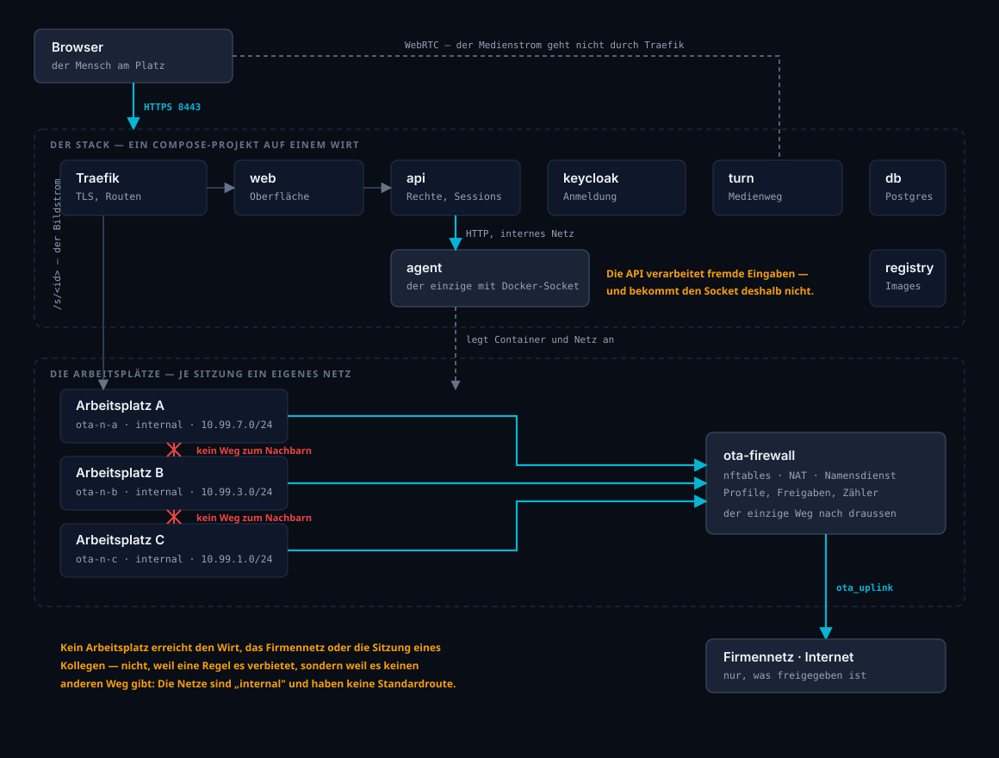

Two statements are in this picture, and both are the answer to a finding:

**Only `agent` touches Docker.** The API processes user input and therefore does not get the
socket — the same separation applies to the host's file system.

| Directory | Contents |
|---|---|
| `web/` | Interface (React, TypeScript, hand-written CSS, no UI library) |
| `api/` | REST API, sign-in, permissions, sessions (FastAPI, PostgreSQL) |
| `agent/` | The **only** service with Docker access; containers, displays, images, shelves, LXCFS, `ota-top` |
| `deploy/` | Compose stack, Traefik, registry, certificates |
| `firewall/` | The router of all workspaces: nftables, NAT, name service, port forwards |
| `extension/` | Firefox extension for the clipboard |
| `docs/wiki/` | Manual — delivered inside the program as help; English in `docs/wiki/en/` |
| `ki/` | The AI gateway `ota-ki`: one entrance for all AI servers, model directory, usage figures |
| `repo/` | The own package source including mirror and management |
| `packaging/` | The packages `ota-selkies`, `ota-ide-ai` and `ota-opencode` |
| `images/` | Own base images: `base-desktop` (Debian + XFCE + Selkies, default), `base-desktop-root` (for root workspaces), `base-xfce` (Ubuntu + KasmVNC) and `turn` |
| `third_party/selkies/` | The fork of Selkies 2.0 with OTA's changes |
| `tests/`, `scripts/` | Checks, setup (Sysbox, LXCFS), certificate, migration from Kasm, data move, diagnostics, bill of materials |

## Documentation

- **[Manual](docs/wiki/en/README.md)** — usage, administration, operations, troubleshooting
  (40 chapters, eight of them for users; [German](docs/wiki/README.md))
- **[plan.md](plan.md)** — architecture **and the reasoning behind it**, including the dead ends
  (German)
- **[docs/adr/](docs/adr/README.md)** — decisions that are expensive to undo, with the alternatives
  that would not have held (German)
- **[roadmap.md](roadmap.md)** — implementation status, honestly (German)
- **[dsgvo.md](dsgvo.md)** — which personal data lives where, for how long, who sees it — and the
  four places where something is missing today (German)
- **[firewall.md](firewall.md)** — the workspaces' network protection: one network per session, a
  router in front, profiles and port forwards in the interface — including the four things that
  turned out differently than planned while building (German)

A note on troubleshooting: [chapter 12](docs/wiki/en/12-fehlersuche.md) describes real failures
from operation with symptom, cause and fix — including several that looked like something else
for days.

## Checks

```bash
make test
```

**More than twenty check suites**, each one establishes its own starting state:

| Suite | Checks |
|---|---|
| `test-authz.sh` | A normal user can provably do nothing administrative and cannot sit at anyone else's screen; plus container hardening, metrics, quotas and second factor |
| `test-ressourcen.sh` | Changed CPU and RAM reach existing containers, running and paused; RAM below current usage waits until the next start, CPU does not; cores are a weight, a one-core container uses more on an idle host; live utilisation sees that load |
| `test-software.sh` | Software monitoring: the inventory reads a running workspace (Debian packages like `apt-mark showmanual`, start entries system-wide and in the home, hidden ones not); after filling the whitelist no alert; a new application is reported with its user; uninstalled or approved, the alert disappears, revoked it comes back |
| `test-git.sh` | OTA Git: switching on and off (data stays), subdomain behind Traefik with the OTA CA, OTA untouched, workspace entrances not on the host; sign-in through Keycloak only for entitled groups, a pre-created account is linked, admins are admins, locked instead of deleted; in the workspace clone/push without password, your own .gitconfig wins, a foreign server gets nothing, SSH via 2222, token revoked at the end, root workspace with a new token after resuming; a different subdomain; nginx as reverse proxy; backup including repositories |
| `test-root-arbeitsplatz.sh` (addition) | A run-once script assigned to a paused root workspace runs on resume as 1000 and shows up with exit code and output under "Show runs" |
| `test-gemeinsame-daten.sh` | Shared data: two root workspaces of the same account run at once, each with its own home; data folders (nested too) are the same in both and in the shared home on the host, owner 1000; settings kept apart; folders with `..`, hidden ones and an unknown persistence are refused; packages reach the root container despite a refused `put_archive`; a vanished container is paused instead of staying "running" and restarts with the same data |
| `test-duplizieren.sh` | Duplicating: settings, apps with their start command, run-once script, per-user allocation, groups and skeleton (also per application, owner 1000) are copied; own slug, disabled, source untouched; only with management rights; a shared image counts as used elsewhere. Own name: applies to that user only, template and admin untouched, too long refused, not for invisible templates, empty resets, goes with the template |
| `test-news.sh` | News: everyone reads, writing only with `settings.manage`; draft invisible and not new; publishing counts for the sidebar, opening resets, a correction does not count again; pinned on top; text stored unchanged; create, change, delete in the log |
| `test-ide-ai.sh` | IDE-AI: fetch models from the AI server, wrong input refused, API key stays on the server, test question; packages in the package source, only the agent gets the file; in every template with an editor config.yaml with mark, context window and response length, telemetry off, Continue linked in VS Code/VSCodium and JetBrains, firewall lets the AI server through, a question from the workspace gets an answer, own config.yaml stays; "set up again" removes Marketplace copies in JetBrains and VSCodium, switches Continue on and puts the own config.yaml aside; turned off, everything is gone again |
| `test-opencode.sh` | opencode and extensions: settings and preview, nonsense refused; pair the memory (wrong key refused), configure, test embeddings, Traefik routes; in a standard workspace with an editor opencode installs alongside IDE-AI; in a root workspace managed configuration, prompt addition, token, package; MCP from the workspace, the contract not; opencode with a fake model: real session instead of the forged one, a subagent writes into the root session, a new session sees nothing, fields `ota_*` invisible to the model; view only signed in and only own workspaces, forged headers have no effect; takeover of an own installation, own default model stays; stopping revokes, resuming issues a new token, the memory is back |
| `test-konten.sh` | Central sign-in accounts: creating in OTA creates in Keycloak (including the required password change), locally it does not get in; changes, password, second factor, locking and deleting take effect in Keycloak; My account goes through Keycloak; a local legacy account moves over with its password, the emergency account does not |
| `test-clipboard-bridge.sh` | Copying between two applications in the same workspace: both directions, umlauts, an image, a megabyte, after a pause, and switched off |
| `test-i18n` (`scripts/i18n-pruefen.py`) | Bilingual: every interface text and every server message has an English entry, no German text bypasses the translation, and every manual chapter exists in English with the same structure |
| `tests/e2e.mjs` | The interface in a real browser — up to the question of whether the stream really connects |
| `test-verzeichnis.sh` | Groups from the directory: both LDAP group forms are recognised, a linked OTA group gets its members at sign-in and on sync, members added by hand stay, an LDAP group "admins" makes nobody an admin, accounts without a group get the note; an application only lets its groups in, via the form **and** the SSO session, without a group nobody; whoever is missing from the directory is disabled |
| `test-verknuepfen.sh` | Linking a domain account to an existing account: afterwards only the old account exists, with the same ID, session and home, under the name from the directory; the account from the first domain sign-in is gone; the old password and the old Keycloak account no longer work; the emergency account cannot be linked; for accounts from Keycloak and for local legacy accounts |
| `test-ldap.sh` | Directory connection **through Keycloak** against a real OpenLDAP in a container — above all that a directory entry does not take over a local account and an outage does not take the emergency access down with it |
| `test-streaming.sh` | The media path with its own template on the current base image: a browser in a foreign network counts the **decoded frames** — on the desktop and on an application's display (Selkies 2.0, WebSockets through Traefik); umlauts, Shift and AltGr of a German keyboard arrive correctly. If TURN is set up (only for golden images with Selkies 1.6.2), it is checked too, including the block list and NAT |
| `test-firewall.sh` | The network protection, **measured from inside**: neighbour, host, company network, TURN, name service, internet per level, rule by name, port forward — and everything again after a restart of the router |
| `test-lxcfs.sh` | LXCFS and `ota-top`: memory and cores per limits in a normal workspace, in a root workspace created without LXCFS after resume and after a start by administrators, in a new root workspace across stop and resume. Skipped without LXCFS |
| `test-root-arbeitsplatz.sh` | The root workspace: root unprivileged on the host (Sysbox), Docker and Compose in the container, network rules for the **inner** containers too, stop and resume with preserved state, rebuild, web terminal with log and export, no terminal into the stack's services, golden images with `USER 1000`, progress bar and start log on start and resume. Skipped without Sysbox |
| `test-repo.sh` | The own package repository: signature, upload (duplicate 409, broken 422), snapshots including protection against deletion, a Debian 13 workspace installs its own package **from here**, "mirror only" no longer calls `deb.debian.org`, the image builder adds and removes the source, an Ubuntu image stays untouched, a root workspace picks up the current setting when resuming. The mirror parts only with a mirror |
| `test-selkies-paket.sh` | The package `ota-selkies`: it is in the package repository, upgrades a workspace on an old golden image with Selkies 1.6.2, the image builder upgrades a golden image, a root workspace upgrades itself when resuming and keeps what was installed in it |
| `test-ki.sh` (run on its own, needs a real AI server) | AI gateway and usage statistics: `ki.ota` inside the workspace, model directory through the gateway, an answer through `ki.ota` and through the intercepted real address, Continue and opencode without a key; requests show up with tokens per person, applications are recognised, probe requests without a model do not count; filters by source, model and application, no figures for fewer than three people; disclosure only with a justification; if `ota-ki` goes down, traffic goes direct |
| `test-backup.sh` | Backup and restore of profile, container and database. Ends sessions for it — **only its own**, and checks that explicitly |

The checks' credentials are in `deploy/.env` and not in the source; the suites read them from
there themselves, so running `make` beforehand is not needed.

Next to it is `make messung` — **not a check but a measurement**: it compares the two streaming
paths under the same load and tells you what a session costs in CPU, bandwidth and response time.
It takes a quarter of an hour and needs a quiet machine, so it does not run with `make test`.
Results and evaluation: [chapter 20](docs/wiki/en/20-selkies-versuch.md#what-it-costs--measured).

A full run takes **about half an hour**: it starts containers, freezes an image and measures in
the browser. Each suite can be started on its own (`bash scripts/test-authz.sh`).

The media path suite exists because the most expensive bugs of this project were exactly there and
no other suite would have found them: a TURN server behind a Docker bridge sending the wrong source
address; a DTLS packet shattering on a small MTU. Both looked the same in the browser — "Waiting
for stream" — and appeared in no log.

## Licence

**Apache-2.0** (see [LICENSE](LICENSE)). Chosen because OTA is infrastructure: no obligations for
the operator, an explicit patent grant, and the same choice as the most closely related open
project (Apache Guacamole).

OTA **contains** no third-party software: dependencies are fetched at build time, components are
pulled as container images at runtime. **They keep their own licences and are not relicensed by
OTA** — broken down into three levels in [THIRD-PARTY-NOTICES.md](THIRD-PARTY-NOTICES.md), briefly
in [NOTICE](NOTICE).

A workspace **image** is a combined work: OTA configuration, Selkies (MPL-2.0, **modified by
OTA**), libx264 (GPL-2.0+), XFCE, hundreds of distribution packages, the installed applications.
It is **not** "Apache-2.0".

The base image **may be redistributed** — with four obligations: offer sources for the GPL parts,
include the five Selkies patches (MPL-2.0 applies per file), leave licence texts in the image and
ship a bill of materials. Finished workspaces with Microsoft VS Code or Google Chrome, on the other
hand, may **not** — the same with VSCodium and Firefox may.

**The applications in a golden image are governed by their own licence.** For Microsoft VS Code,
operation within your own company network is explicitly allowed, passing it on to third parties is
not. Checked with original quotes in [manual, chapter 13](docs/wiki/en/13-lizenzen.md) — not legal
advice, but based on the licence text and not on memory.

"Kasm" is a trademark of Kasm Technologies. OTA is not a Kasm product and is not affiliated with
Kasm Technologies.
