<!-- Sprachen: Deutsch (hier) · English -->
**Deutsch** · [English](README.en.md)

<p align="center">
  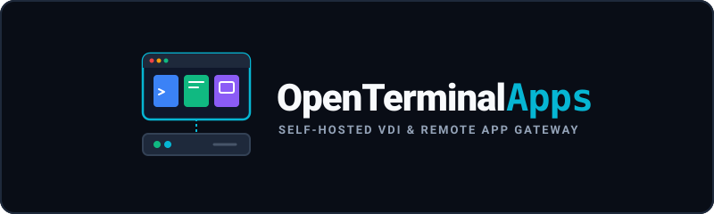
</p>

# OpenTerminalApps

Selbstgehostete Plattform, die jedem Nutzer **einen eigenen Linux-Arbeitsplatz im Browser** gibt.
Darin sind seine Werkzeuge installiert — VS Code, VSCodium, JetBrains, Firefox, ein Terminal —, und
jedes lässt sich einzeln formatfüllend streamen. Alle teilen sich **ein Zuhause**: dieselben
Projekte, denselben SSH-Schlüssel, dieselbe Zwischenablage.

Daneben lassen sich einzelne Anwendungen als Wegwerf-Container starten und vorhandene Kasm-Images
sowie ganze Registries einbinden — als Zusatz, nicht als Fundament.

**Jeder Arbeitsplatz hängt in einem eigenen Netz** hinter einem Router: kein Firmennetz, keine
Nachbarsitzung, kein Wirt — bis jemand es ausdrücklich freigibt ([firewall.md](firewall.md)).

> **Stand:** läuft und wird benutzt. Über zwanzig Prüfreihen mit mehreren hundert automatischen
> Prüfungen, ein Teil davon in einem echten Browser. Was noch fehlt, steht offen in
> [roadmap.md](roadmap.md) — nichts davon ist beschönigt.

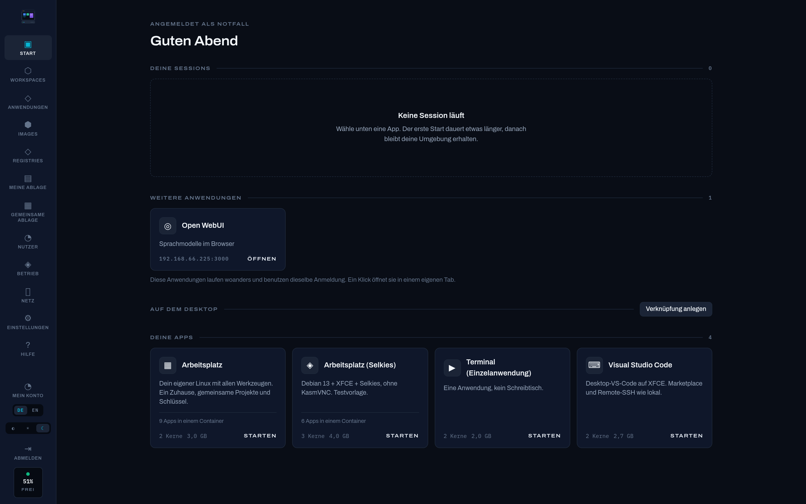

*Der Start: die eigene laufende Sitzung mit ihren Anwendungen, was sie an Kernen und Speicher
bekommen hat — und was sie im Netz darf. Darunter, was sich sonst noch starten lässt.*

**Inhalt:** [Schnellstart](#schnellstart) · [Aktualisieren](#aktualisieren) ·
[Was es kann](#was-es-kann) — [Arbeitsplatz](#für-alle-der-arbeitsplatz-im-browser),
[Root-Arbeitsplatz](#root-arbeitsplatz-root-und-docker-im-container),
[Entwickeln](#entwickeln-git-und-ki-im-editor-und-im-terminal),
[KI-Durchgang und KI-Nutzung](#ki-durchgang-und-ki-nutzung),
[Workspaces](#workspaces-und-ressourcen), [Software und Images](#software-und-images),
[Konten](#konten-anmeldung-und-rechte), [Netz](#das-netz-der-arbeitsplätze),
[Betrieb](#betrieb-und-überwachung), [Streaming](#streaming-und-basisimage) ·
[Ein Blick in die Verwaltung](#ein-blick-in-die-verwaltung) · [Wie es gebaut ist](#wie-es-gebaut-ist) ·
[Dokumentation](#dokumentation) · [Prüfungen](#prüfungen) · [Lizenz](#lizenz)

---

## Schnellstart

**Voraussetzungen** auf einem Linux-Host: `docker` mit dem Compose-Plugin (`docker compose version`
muss antworten), dazu `git`, `make` und `openssl`. Die Ports **8443** und **8081** müssen frei sein
— 443 bleibt bewusst unbelegt, damit ein bestehendes Kasm daneben weiterlaufen kann. Beide sind über
`OTA_HTTPS_PORT` und `OTA_HTTP_PORT` in `deploy/.env` änderbar.

Dazu **30000–30019** als Vorrat für Portfreigaben. Der Bildstrom braucht **keinen** eigenen Port:
Selkies 2.0 überträgt über WebSockets durch denselben HTTPS-Port wie die Oberfläche. Nur Golden
Images, die noch auf dem alten Basisimage mit Selkies 1.6.2 gebaut sind, brauchen **3478** (TURN)
und **49160–49260/UDP**. Steht OTA hinter einer Firewall mit Portweiterleitung, reicht nach aussen
**443** — welche Ports wohin, und was dafür in `deploy/.env` gehört, steht in
[Kapitel 24](docs/wiki/24-hinter-nat.md). Und ein Adressbereich für die Arbeitsplatznetze, ab
Werk `10.99.0.0/16` — er darf sich **nicht** mit dem Firmennetz überschneiden. Alles einstellbar,
alles erklärt in [`deploy/.env.example`](deploy/.env.example) und
[Kapitel 2](docs/wiki/02-erste-schritte.md).

```bash
git clone https://github.com/bmetallica/openterminalapps.git
cd openterminalapps

sudo make setup                  # .env mit Geheimnissen, Zertifikat, Verzeichnisse
sudo make up                     # Stack bauen und starten (beim ersten Mal einige Minuten)
sudo make admin NAME=deinname    # erstes Administratorkonto
```

**Hinter einem Firmenproxy** kommen drei Zeilen in `deploy/.env` dazu — `OTA_HTTP_PROXY`,
`OTA_HTTPS_PROXY` und vor allem `OTA_NO_PROXY`, damit die Dienste untereinander **nicht** über den
Proxy reden. Ohne Proxy ist nichts zu tun; das ist die Vorgabe.
[Handbuch, Kapitel 21](docs/wiki/21-firmenproxy.md) beschreibt auch, was OTA dabei *nicht* lösen
kann: `docker pull` macht der Docker-Daemon und braucht seine eigene Konfiguration.

`make setup` **erzeugt die Geheimnisse und trägt sie selbst ein** — nachträglich ist nichts von Hand
zu ergänzen. Ein zweiter Aufruf lässt vorhandene Werte unangetastet.

`sudo` braucht es, weil OTA Verzeichnisse unter `/srv/ota` anlegt und mit dem Docker-Socket spricht.
Wer in der Gruppe `docker` ist und `/srv/ota` selbst angelegt hat, kann es weglassen.

`make admin` legt **zwei** Konten an und druckt beide Passwörter — sie werden nur dieses eine Mal
gezeigt:

| Konto | Wo es liegt | Wofür |
|---|---|---|
| `<deinname>` | in Keycloak | der Alltagszugang; die Anmeldung verlangt sofort ein eigenes Passwort |
| `notfall` | lokal in OTA | der Ausweg, wenn Keycloak einmal nicht antwortet |

Das zweite ist keine Dreingabe: Ab dem Moment, in dem die Anmeldung über einen weiteren Dienst
läuft, braucht es einen Weg herein, der ohne ihn funktioniert. Er ist unter `/notfall` erreichbar,
und jede Anmeldung darüber steht im Protokoll.

```
https://<host>:8443/            # leitet zur zentralen Anmeldung weiter
https://<host>:8443/notfall     # der lokale Notzugang
```

**Einmalig das Wurzelzertifikat importieren**, dann warnt der Browser nicht mehr — auch nach jedem
späteren Zertifikatswechsel:

```bash
sudo cp deploy/certs/ota-ca.crt /usr/local/share/ca-certificates/ota-ca.crt   # Linux, systemweit
sudo update-ca-certificates
```

Im Browser: Einstellungen → Zertifikate → Zertifizierungsstellen → `deploy/certs/ota-ca.crt`
importieren, „Websites vertrauen" ankreuzen.

**Läuft es?**

```bash
make ps                          # alle Dienste sollten "healthy" sein
curl -k https://localhost:8443/healthz
```

Die Antwort nennt vier Dinge: `db`, `agent`, `keycloak` und den Gesamtzustand. Steht dort
`"keycloak":"nicht erreichbar"`, ist der Realm noch nicht eingerichtet oder der Dienst noch nicht
oben — nachholen mit:

```bash
sudo make identity               # Realm, Clients, Rollen; idempotent
```

`make up` tut das von selbst und wartet dafür, bis Keycloak antwortet (beim ersten Start rund eine
halbe Minute).

Wenn etwas klemmt: `make logs` und [Handbuch, Kapitel 12](docs/wiki/12-fehlersuche.md) — dort stehen
echte Fehler aus dem Betrieb mit Symptom, Ursache und Reparatur.

### Der erste Arbeitsplatz

**Das Basisimage baut `make up` beim ersten Start mit** — `ota/base-desktop:1`, Debian 13 + XFCE +
Selkies, ohne KasmVNC. Das dauert einige Minuten und passiert nur, wenn es fehlt; danach steht es
unter **Workspaces** zur Auswahl. Neu bauen geht jederzeit von Hand:

```bash
scripts/build-desktop-image.sh --pruefen      # baut und misst die Punkte des Vertrags mit dem Agent
```

Ein Abbild von Kasm braucht es dafür **nicht**. Die bleiben möglich, sind aber die Ausnahme — für
fertige Kataloge und für den Umstieg ([Kapitel 9](docs/wiki/09-kasm-images-und-registries.md)).

Danach: **Workspaces → Anlegen** — der Knopf legt sofort eine Vorlage an und nimmt dafür das eigene
Basisimage, sonst ein anderes, das nach einem Arbeitsplatz aussieht. Im Editor der Gruppe `users`
zuweisen und einschalten, dann unter **Start** starten und über **Software → Im Image nachsehen**
die Anwendungen freigeben. Ausführlich in [Handbuch, Kapitel 2](docs/wiki/02-erste-schritte.md).

## Aktualisieren

Eine neue Fassung aus dem Repository holen:

```bash
cd openterminalapps
sudo make backup          # erst sichern, dann ändern
git pull
sudo make update          # .env ergänzen, bauen, starten
```

Ab dem ersten Schritt zeigt jede OTA-Seite (Dashboard, Anmeldung, jede Sitzung) ein Banner
„**Achtung!** OTA Update im Gange, bitte laden Sie alle OTA-Seiten neu, sobald diese Meldung
verschwunden ist.“ Es verschwindet, sobald die neue API gesund ist; scheitert das Update, bleibt es
stehen ([Kapitel 11](docs/wiki/11-betrieb.md#das-banner-während-des-updates-)).

`make update` macht drei Dinge in dieser Reihenfolge, und die Reihenfolge ist nicht beliebig:

1. **Fehlende Einstellungen ergänzen.** Bringt eine Fassung neue Werte in `deploy/.env.example`
   mit, trägt `make update` sie mit sinnvollen Vorgaben nach. **Vorhandene Werte bleiben
   unangetastet** — auch die Geheimnisse. Passierte das erst nach dem Bauen, startete ein Dienst
   gegen eine Variable, die es noch nicht gibt.
2. **Bauen und starten — mit Sicherheitsupdates.** Die fremden Dienste (Postgres, Keycloak,
   Traefik …) kommen innerhalb ihrer Versionsreihe frisch aus dem Netz, die eigenen Images auf
   frischer Basis und mit den Paket-Updates der Woche. Ohne Netz geht es mit dem Vorhandenen
   weiter. Die Datenbank wandert dabei von selbst mit: Alembic beim Start der API, und fehlende
   Spalten zieht OTA aus dem Modell nach. Es gibt keinen Migrationsschritt von Hand.
3. **Sagen, was *nicht* von selbst passiert.** Siehe unten.

### Was ein Update nicht anfasst

| | Warum, und was zu tun ist |
|---|---|
| **Laufende Sitzungen** | Sie behalten ihr Abbild, bis sie beendet werden. Das ist Absicht: Niemand soll mitten in der Arbeit unterbrochen werden. Wer die Neuerungen sofort will, beendet seinen Arbeitsplatz und startet ihn neu. |
| **Das Basisimage** | Wird nicht bei jedem Update neu gebaut — es dauert Minuten, und die meisten Fassungen fassen es nicht an. `make update` **prüft** aber, ob die Bauanleitung neuer ist als das gebaute Abbild, und sagt es dann. Bauen mit `scripts/build-desktop-image.sh --pruefen`. |
| **Die Arbeitsplatz-Images** | Ein neues Basisimage wirkt erst, wenn die davon abgeleiteten Images neu gebaut werden — in der Verwaltung unter **Software**. |
| **`deploy/.env`** | Wird nur ergänzt, nie überschrieben. Wer eine Einstellung ändern will, tut das selbst; die Vorlage daneben erklärt jede. |

### Später auf einen Firmenproxy umstellen

Derselbe Weg, im laufenden Betrieb und ohne Neuaufsetzen: die drei Zeilen in `deploy/.env`
eintragen, `sudo make update`. Dienste und **neue** Sitzungen übernehmen ihn sofort; laufende
behalten ihren Stand bis zum nächsten Start. Das Basisimage muss dafür **nicht** neu gebaut
werden — der Proxy steckt nie im Image. Zurückstellen ist derselbe Weg.

Gemessen in beide Richtungen; die Stolperstellen stehen in
[Kapitel 21](docs/wiki/21-firmenproxy.md).

### Hinter einer Firewall mit NAT

Nutzer kommen von aussen über die Adresse der Firewall, OTA steht dahinter, vielleicht mit einem
Reverse Proxy davor und dem Verzeichnis auf der anderen Seite. Nach aussen weiterzuleiten ist
**443** (auf den Proxy, mit WebSockets — auch der Bildstrom geht seit Selkies 2.0 dort durch); ins
äussere Netz braucht Keycloak **636** zum Verzeichnis. Nur solange Golden Images mit Selkies 1.6.2
laufen, kommt **3478/TCP** direkt auf den OTA-Host dazu, und in `deploy/.env` zwei TURN-Adressen,
die der Firewall und die eigene:

```bash
OTA_TURN_HOST=10.50.0.33        # die Firewall — so sehen die Browser den TURN
OTA_TURN_BIND=192.168.1.22      # der Host — daran bindet sich coturn
OTA_TURN_PROTOCOL=tcp
OTA_TURN_ICE_POLICY=relay
OTA_TRUSTED_PROXIES=192.168.1.23/32
```

Eine Hairpin-NAT an der Firewall braucht es nicht: Der Router der Arbeitsplätze biegt die
veröffentlichte Adresse selbst auf den Host um. Die CA des Verzeichnisses gehört nach
`deploy/keycloak-truststore/`. Vollständige Portlisten, ein Beispiel für nginx und die Prüfung:
[Kapitel 24](docs/wiki/24-hinter-nat.md).

### Root-Arbeitsplätze freischalten

Root und Docker im Arbeitsplatz brauchen **Sysbox** auf dem Host. Das Paket will bei der
Installation Docker neu starten und schlägt vor, dafür alle Container zu löschen — das Skript
umgeht das und fasst keinen Container an:

```bash
sudo scripts/sysbox-einrichten.sh --pruefen          # Voraussetzungen ansehen
sudo scripts/sysbox-einrichten.sh --live-restore     # einrichten
sudo make up                                         # baut ota/base-desktop-root:1
```

Dann eine Vorlage der Klasse „Root mit Docker" anlegen und das Recht „Root-Arbeitsplatz nutzen" an
die Gruppen vergeben, die es bekommen sollen. Ausführlich in
[Kapitel 25](docs/wiki/25-root-arbeitsplatz.md).

### Eigene Grenzen im Arbeitsplatz (LXCFS)

Damit `free`, `htop` und `uptime` im Arbeitsplatz dessen Grenzen zeigen statt der des Hosts,
richtet `make up` (und damit auch `make update`) **LXCFS** auf dem Host ein: Es installiert das
Debian-Paket, falls es fehlt, und setzt die nötigen Optionen. Ein laufendes LXCFS, das schon
benutzt wird, startet es dafür nicht neu. Nachsehen geht mit:

```bash
sudo scripts/lxcfs-einrichten.sh --pruefen
```

**Laufende Arbeitsplätze bekommen es erst beim nächsten Start**, Root-Arbeitsplätze beim nächsten
Fortsetzen, ohne Neuaufsetzen. Wer es nicht will, setzt `OTA_LXCFS=aus` in `deploy/.env`. Siehe
[Kapitel 11](docs/wiki/11-betrieb.md#im-arbeitsplatz-lxcfs-und-ota-top-).

### Den Spiegel der Paketquelle einschalten

Die eigene Paketquelle läuft immer — über sie kommt `ota-selkies`, der Streaming-Server, in die
Arbeitsplätze. Ein **Spiegel** von Debian 13 und Dockers Paketquelle ist ein Zusatz, ab Werk aus.
Ein Vollspiegel braucht grob 100 bis 130 GB:

```bash
# in deploy/.env
OTA_REPO_SPIEGEL=1
OTA_REPO_ROOT=/srv/ota/repo
sudo make update
```

Dann unter **Verwaltung → Paketquellen** einmal abgleichen. Ausführlich in
[Kapitel 26](docs/wiki/26-paketquellen.md).

### Wenn etwas schiefgeht

```bash
sudo make ps              # welcher Dienst steht nicht?
sudo make logs            # was sagt er?
```

Die Sicherung von oben spielt `scripts/restore-db.sh` zurück. Die **Profile der Nutzer** liegen
unter `/srv/ota/profiles` und werden von einem Update nicht angefasst — sie überstehen auch ein
vollständiges Neuaufsetzen des Stacks.

Ein Rückschritt auf die vorige Fassung ist `git checkout <alter-stand> && sudo make update`. Was
dabei **nicht** zurückwandert, ist die Datenbank: Neue Spalten bleiben stehen. Sie stören eine
ältere Fassung nicht, aber Daten, die es vorher nicht gab, sind dann eben da.

## Was es kann

Die Übersicht folgt den Rollen: zuerst, was jeder Mensch im Arbeitsplatz bekommt, dann Entwicklung
und KI, dann Verwaltung, Netz und Betrieb. Jeder Punkt verweist auf das Kapitel des Handbuchs, das
ihn vollständig erklärt.

### Für alle: der Arbeitsplatz im Browser

- **Ein Container je Mensch und Vorlage**, darin jede Anwendung auf ihrem eigenen Bildschirm,
  gestartet erst bei Bedarf. Das Dashboard zeigt die laufende Sitzung mit ihren Anwendungen, mit
  den Kernen und dem Speicher, die sie bekommen hat, und mit dem, was sie im Netz darf. Darunter
  stehen die Kacheln aller anderen Vorlagen, die sich starten lassen
  ([Kapitel 3](docs/wiki/03-arbeitsplatz.md), [29](docs/wiki/29-los-gehts.md))
- **Jede Anwendung in einem eigenen Browsertab**, mit eigener Adresse, und als Verknüpfung auf dem
  Desktop ablegbar (PWA). Der klassische XFCE-Desktop steht als zusätzliche Ansicht bereit
- **Der ferne Bildschirm wächst mit dem Fenster**, ohne schwarzen Rand und ohne Skalierung. Die
  Kontrollleiste der Sitzung regelt Bildschirm, Tastatur, Ton und die Ablagen. Umlaute, Shift und
  AltGr einer deutschen Tastatur kommen richtig an, der Ton läuft in den Browser
  ([Kapitel 34](docs/wiki/34-bedienung.md))
- **Zwischenablage in beide Richtungen**, auch für Bilder und auch zwischen zwei Anwendungen im
  selben Container ([Kapitel 4](docs/wiki/04-zwischenablage.md))
- **Ein Zuhause für alle Anwendungen**: dieselben Projekte, derselbe SSH-Schlüssel, dieselben
  Einstellungen. Es überdauert jeden Container: Wenn bei OTA etwas „gelöscht" wird, ist es der
  Container, nicht das Zuhause. Die einzige Ausnahme sind Vorlagen, die ausdrücklich *flüchtig*
  eingestellt sind ([Kapitel 31](docs/wiki/31-dateien.md))
- **Drei Ablagen**:
  - die gemeinsame für Dateien, die in jeden Arbeitsplatz sollen (im Container nur lesbar);
  - eine **eigene je Mensch** unter `/mnt/austausch`, beschreibbar, der Weg hinein und wieder
    heraus;
  - ein **Laufwerk je Gruppe** unter `/mnt/gruppen/<name>` mit denselben Dateien für ein Team.

  Alle drei stehen auch in der Kontrollleiste einer laufenden Sitzung, mit Ziehen und Ablegen. Über
  ein Gruppenlaufwerk entscheidet allein die Mitgliedschaft; auch ein Administrator kommt nur an die
  Gruppen, in denen er selbst ist ([Kapitel 17](docs/wiki/17-ablage-und-startskript.md))
- **Die eigene Auslastung sehen**: `free`, `htop` und `uptime` zeigen über LXCFS den Speicher, die
  Kerne, die Last und die Laufzeit **des eigenen Arbeitsplatzes**, nicht die des Hosts. Für die CPU
  gibt es **`ota-top`**. Es liest die cgroup und zeigt:
  - die Nutzung, die zugeteilten Kerne und die Obergrenze;
  - ob der Arbeitsplatz gerade gebremst wird und ob der Speicher volllief;
  - wie lange Programme auf CPU, Speicher oder Platte warteten;
  - die Programme mit der meisten CPU.

  Siehe [Kapitel 33](docs/wiki/33-entwickeln.md#wie-ausgelastet-ist-mein-arbeitsplatz-).
- **Kacheln für sich umbenennen**, ohne dass sich für andere etwas ändert. Das Menü **⋯** auf der
  Kachel richtet die KI-Werkzeuge neu ein, setzt einen Root-Arbeitsplatz neu auf und öffnet die
  Ansichten von Erweiterungen
- **Mein Konto**: das Passwort ändern und einen zweiten Faktor einrichten, als Passkey oder als
  Einmalkennwort, mit Rückfallcodes. Bei Verzeichniskonten geschieht das im Verzeichnis
  ([Kapitel 30](docs/wiki/30-mein-konto.md))
- **News** von der Verwaltung, mit einem Punkt in der Seitenleiste für Ungelesenes.
  **Meine KI-Nutzung** zeigt die eigenen Zahlen, der Punkt **DSGVO** erklärt, was erfasst wird
- **Das Handbuch im Programm**, auf Deutsch und Englisch und gefiltert nach Rechten. Es hat eigene
  Kapitel für Anwender: erste Schritte, Konto, Dateien, Root-Arbeitsplatz, Git und KI, Bedienung,
  Hilfe bei Problemen und Begriffe ([Kapitel 29 bis 36](docs/wiki/29-los-gehts.md))
- **Deutsch oder Englisch, dunkel oder hell** (oder wie der Rechner eingestellt ist), umschaltbar
  oben rechts und schon vor der Anmeldung
- **Wer zusieht, steht im Protokoll.** Auf eine laufende Sitzung schalten kann sich nur ein voller
  Administrator, ein Supporter nicht. Jedes Aufschalten wird mit beiden Namen protokolliert und ein
  Jahr aufbewahrt ([Kapitel 3](docs/wiki/03-arbeitsplatz.md#wer-sonst-noch-auf-deinen-bildschirm-sehen-kann))
- **Abmelden nach Untätigkeit, nicht nach Zeit.** Die Frist ist rollend und zwischen 30 Minuten und
  48 Stunden einstellbar: Wer arbeitet, wird nicht abgemeldet, und kurze Aussetzer der API werfen
  niemanden hinaus. Arbeitsplätze ohne Aktivität werden je Vorlage pausiert, gestoppt oder
  gelöscht; das Zuhause bleibt immer erhalten

### Root-Arbeitsplatz: root und Docker im Container

- **root, Docker und `docker compose` im Container**, unter Sysbox und damit ohne `--privileged`:
  root im Container ist auf dem Host unprivilegiert ([Kapitel 25](docs/wiki/25-root-arbeitsplatz.md),
  für Nutzer [Kapitel 32](docs/wiki/32-root-arbeitsplatz-nutzen.md))
- **Beenden hält an, statt zu löschen.** Was installiert wurde, bleibt, auch Docker-Images und
  Container, und der Arbeitsplatz behält seine feste Adresse. **Neu aufsetzen** holt ein neues
  Basisimage
- **Dieselben Netzregeln für die inneren Container.** Sie gehen durch denselben Router. Ihre Netze
  kommen aus einem festen Bereich (`OTA_ROOT_DOCKER_NETZE`) und überdecken das LAN nicht
- **Schnell fortsetzen**: Ein Startbalken auf der Kachel zeigt den aktuellen Schritt. Fortgesetzt
  wird, ohne auf die Platzmessung oder die inneren Container zu warten. Alte PID-Dateien von dockerd
  und containerd räumt OTA beim Start weg
- **Prozessgrenze 32768** statt 4096, einstellbar über `OTA_ROOT_PIDS_LIMIT`, damit Compose-Stapel
  und Builds nicht an der Grenze scheitern
- **Mehrere gleichzeitig**: Mit der Persistenz *Gemeinsame Daten* laufen zwei Root-Arbeitsplätze
  eines Menschen nebeneinander. Jeder hat eigene Einstellungen, `Desktop`, `Documents` und Co.
  kommen aus dem gemeinsamen Zuhause
- **Zwei eigene Rechte**: *Root-Arbeitsplatz nutzen* und *Per Webterminal als root in laufende
  Arbeitsplätze*. Jede Eingabe im Webterminal wird mit Namen protokolliert und ist exportierbar
  ([Kapitel 8](docs/wiki/08-nutzer-und-gruppen.md#zwei-rechte-für-root-arbeitsplätze-))
- **Hebt sich beim Fortsetzen an**: neues Selkies, IDE-AI, opencode, Git-Token, Paketquelle,
  LXCFS, Einmal-Skripte und `ota-top`. Ein Root-Arbeitsplatz muss dafür nicht neu aufgesetzt werden

### Entwickeln: Git und KI im Editor und im Terminal

- **OTA-Git (Forgejo)**, im Menü ein- und ausschaltbar ([Kapitel 27](docs/wiki/27-git.md)):
  - Läuft unter einer eigenen Subdomain hinter demselben Eingang wie OTA.
  - Anmeldung mit den OTA-Zugangsdaten über Keycloak, nur für berechtigte Gruppen.
  - OTA legt die Konten an und sperrt sie, statt sie zu löschen. OTA-Admins sind dort ebenfalls
    Admins.
  - Arbeitsplätze und Root-Arbeitsplätze bekommen Git vorkonfiguriert: ein Token je Arbeitsplatz,
    widerrufen beim Ende; SSH nur im Containernetz. Andere Git-Server bleiben unberührt, eine eigene
    `.gitconfig` hat Vorrang.
- **IDE-AI**, unter Einstellungen ein- und ausschaltbar: ein KI-Assistent (Continue) in VS Code,
  VSCodium und PyCharm/IntelliJ, verbunden mit dem eigenen KI-Server. Das kann vLLM, llama.cpp oder
  jeder andere Server mit OpenAI-Schnittstelle sein ([Kapitel 28](docs/wiki/28-ide-ai.md)):
  - Modelle als Auswahlliste, je Modell mit Kontextfenster und Antwortlänge; dazu Werkzeuge
    (Agent-Modus), Temperatur, Zeitlimit, Regeln und berechtigte Gruppen.
  - Die Pakete kommen aus der eigenen Paketquelle in jeden Arbeitsplatz mit passendem Editor, auch
    in Ubuntu- und Kasm-Images.
  - Continue steht rechts in der Seitenleiste, Copilot ist aus, die Telemetrie von Continue ebenso.
  - Die Firewall gibt den KI-Server frei, solange IDE-AI an ist.
  - Hat ein Marketplace-Update oder eine eigene Konfiguration Continue verdrängt, stellt **⋯ →
    KI-Werkzeuge neu einrichten** OTAs Fassung wieder her.
- **opencode**, unter Einstellungen ein- und ausschaltbar: der KI-Assistent im Terminal, mit dem
  KI-Server und den Modellen aus IDE-AI ([Kapitel 38](docs/wiki/38-opencode.md)):
  - Das Paket kommt aus der eigenen Paketquelle in der festgelegten Fassung. Ein selbst
    installiertes opencode wird übernommen, das Original bleibt als `*.vor-ota`.
  - OTA schreibt opencodes verwaltete Konfiguration nach `/etc/opencode/`. Eigene Einstellungen in
    `~/.config/opencode` kommen dazu, ein eigenes Standardmodell bleibt.
  - Ein Zusatz zum Systemprompt, global und je Gruppe, mit Vorschau und Audit-Log.
  - Weitere MCP-Server, entfernt oder lokal, mit API-Schlüssel, je Server für Gruppen freigegeben.
- **Erweiterungen**: eigenständige Docker-Anwendungen mit eigenem Compose-Projekt. Sie sind über
  einen Vertrag an OTA gekoppelt und für Gruppen einschaltbar
  ([Kapitel 39](docs/wiki/39-erweiterungen.md)):
  - Jeder Arbeitsplatz bekommt ein eigenes Token; MCP-Server und Prompt-Schnipsel gehen an opencode.
  - Kein Hostport und keine Firewallregel. Kontolöschung, Sperren und Sicherung laufen mit.
  - Die erste ist das **Gedächtnis für opencode**
    ([plugin_ota-opencode](https://github.com/bmetallica/plugin_ota-opencode)): Jede
    opencode-Sitzung bekommt ein eigenes Langzeitgedächtnis, mit Embeddings von vLLM oder llama.cpp.
    In der Seitenleiste unter **opencode · Erinnerungen** gibt es:
    - die Einträge jeder Sitzung zum Lesen, Bearbeiten, Anheften, Kopieren und Verschieben;
    - Lesezugriff einer Sitzung auf das Gedächtnis einer anderen;
    - ein **Hauptgedächtnis**, das alle Sitzungen eines Menschen mitlesen;
    - eine **Dokumentenbibliothek** (PDF, Office, Text), die opencode mit Quellenangabe durchsucht.
      Zugangsdaten im Text werden beim Auslesen entfernt.

### KI-Durchgang und KI-Nutzung

- **Mehrere KI-Server unter einem Namen.** Der erste Server gilt für alle, jeder weitere kommt für
  seine **Gruppen** dazu. Continue und opencode sehen ein gemeinsames Modellverzeichnis über alle
  Server ([Kapitel 28](docs/wiki/28-ide-ai.md#mehrere-ki-server-ki-durchgang-und-nutzungsstatistik))
- **KI-Durchgang** (`ota-ki`, optional): Die Arbeitsplätze sprechen `ki.ota` an. Der Schlüssel des
  KI-Servers bleibt draußen aus den Zuhausen, und die Firewall fängt auch Verbindungen ab, die
  Skripte direkt an die echte Adresse eines Servers schicken. Fällt der Durchgang aus, geht der
  Verkehr von selbst wieder direkt. HTTPS zum KI-Server wird mit Zertifikatsprüfung gesprochen.
  Direkte HTTPS-Verbindungen aus einem Skript werden ungelesen durchgereicht und nur als Verbindung
  gezählt
- **Externe Dienste wie Open WebUI** sprechen die KI auf Wunsch ebenfalls über den Durchgang an. Sie
  bekommen einen eigenen Schlüssel und unterliegen derselben Gruppenregel und derselben Statistik.
  Zugeordnet wird je Mensch über die Kopfzeilen von Open WebUI
- **KI-Nutzung unter Betrieb** (optional, ab Werk aus). Gezählt werden **nur echte Aufrufe eines
  Modells**; Abfragen wie `/v1/models`, `/health` oder Anmeldeseiten von Überwachungsdiensten
  bleiben draußen:
  - **Ohne Namen**: Summen, Verlauf und eine Verteilung nach Tageszeit. Dazu Ringdiagramme je
    Vorlage, Modell, Server und **Anwendung**, je Mensch und Arbeitsplatz nur nach Rang und erst
    ab drei.
  - **Filter** nach Quelle (gesamt, nur OTA, nur Open WebUI), Modell und Anwendung. Sind weniger
    als drei Menschen in der Auswahl, zeigt die Seite keine Zahlen.
  - **Erkannte Anwendungen**: opencode, Continue, Cline, Roo Code, Kilo Code, Aider und Copilot.
    Dazu VS Code und die JetBrains-IDEs, die OTA aus der Vorlage ableitet, und Open WebUI. Bei
    Skripten nennt die Statistik die Sprache: Java, Node oder Python.
  - **Namen und Einzelverläufe** gibt es nur nach einer **Begründung**, die mit Namen im Protokoll
    steht, und nur für 30 Minuten.
  - Jeder sieht unter **Meine KI-Nutzung** die eigenen Zahlen. Ein Punkt **DSGVO** in der
    Seitenleiste informiert alle; den Text kann die Verwaltung anpassen.
  - Inhalte werden nie erfasst, die Aufbewahrung ist einstellbar.

### Workspaces und Ressourcen

- **Der Editor einer Vorlage**: Image, Betriebsart, Streaming-Weg, Netz, Apps, Ressourcen, Rechte,
  Umgebung und Zuteilung, alles auf einem Bildschirm. Die **Kapazitätsanzeige** zeigt vorher,
  ob der Host überbucht wäre, statt es erst am OOM-Kill zu merken
  ([Kapitel 5](docs/wiki/05-workspaces-verwalten.md))
- **Ressourcen je Mensch und Workspace**: A bekommt 2 Kerne, B einen
  ([Kapitel 6](docs/wiki/06-ressourcen-und-zuteilung.md)). Geänderte CPU- und RAM-Werte erreichen
  auch vorhandene Container, laufend und pausiert
- **Kerne als Gewicht, nicht als Deckel.** Ist der Host frei, darf ein Arbeitsplatz bis zum
  Vierfachen nutzen; ist er voll, teilt der Kernel im Verhältnis auf. Dadurch ruckelt nichts mehr,
  während der Host halb leer steht
- **Workspaces duplizieren**, mit Apps, Einmal-Skripten, Zuteilungen, Gruppen und Skeleton. So wird
  etwa ein fertig eingerichteter Root-Arbeitsplatz zur Vorlage für den nächsten
  ([Kapitel 5](docs/wiki/05-workspaces-verwalten.md#duplizieren-))
- **Persistenz** je Vorlage: *Pro Nutzer* (ein Zuhause für alle Workspaces, der Normalfall), *Pro
  Workspace*, *Flüchtig* oder *Gemeinsame Daten*. Mit Gemeinsamen Daten laufen mehrere
  Arbeitsplätze gleichzeitig, jeder mit eigenen Einstellungen und denselben Datenordnern
- **Kontingent je Zuhause und eine Untergrenze für den freien Plattenplatz.** Wer an die Grenze
  kommt, bekommt eine verständliche Ablehnung, statt dass ein Container mitten in der Arbeit beim
  Schreiben stehenbleibt.
  - **Speicherabbilder** abgestürzter Programme (`core.<pid>`) füllen kein Zuhause mehr. Neue
    Container erzeugen keine, und was in bestehenden noch entsteht, räumt OTA vor jeder Messung und
    täglich weg ([Kapitel 11](docs/wiki/11-betrieb.md#speicherabbilder-räumt-ota-selbst-)).
  - Die **Platzmessung** läuft einzeln im Hintergrund, je Arbeitsplatz höchstens einmal in der
    Stunde (`OTA_PLATZ_MESSEN_MINUTEN`), und beim Anhalten eines Root-Arbeitsplatzes.
- **Zwischenablage je Workspace und Gruppe**: Einfügen, Kopieren, Bilder und die Markieren-Auswahl
  lassen sich einzeln schalten. Gruppen können strenger sein als der Workspace, nie großzügiger
  ([Kapitel 37](docs/wiki/37-zwischenablage-verwaltung.md))
- **Skeleton-Profil** je Workspace: Damit fängt ein Zuhause an, samt `.bashrc`, `.profile` und
  `.bash_logout`. Einzelne Pfade lassen sich auf Wunsch bei jedem Start durchsetzen; das ist die
  Ausnahme, nicht die Regel. Dazu gibt es **je Anwendung einen eigenen Teilbaum**, der erst kommt,
  wenn diese Anwendung zum ersten Mal startet
  ([Kapitel 17](docs/wiki/17-ablage-und-startskript.md))
- **Skript beim Sessionstart** je Workspace, für alles, was ins Zuhause gehört, aber nicht ins
  Image, etwa ein Firmenzertifikat
- **Einmal-Skripte** je Workspace laufen je Mensch genau einmal, auch beim Fortsetzen von
  Root-Arbeitsplätzen. Sie sind für Umstellungen im Zuhause gedacht, die das Skeleton nicht mehr
  erreicht. Unter **Läufe ansehen** stehen Rückgabewert und Ausgabe

### Software und Images

- **Pakete anklicken, Image bauen, Fassung aktivieren**, mit Protokoll und Rückrollen
  ([Kapitel 7](docs/wiki/07-golden-images.md))
- **Pakete werden vorher geprüft**: Kennt das Image den Namen, und taugt das Paket überhaupt?
  Ubuntus `firefox` etwa ist nur ein Verweis auf ein Snap und im Container nutzlos
- **Rezepte** für alles, was kein einfaches Paket ist, mit einem geführten Bauer für eigene
- **Session einfrieren**: im eigenen Arbeitsplatz einrichten, die Vorschau ansehen und als neue
  Fassung übernehmen. Das Zuhause bleibt draußen, Geheimnisse werden markiert, die sudo-Ausnahme
  wird entfernt
- **Anwendungen im Image finden**: OTA liest die `.desktop`-Dateien und schlägt Name, Zeichen und
  Startbefehl vor. Niemand muss wissen, wo eine Binärdatei liegt
- **Das echte Symbol aus dem Paket**, also der Fuchs statt eines Kreises. OTA sucht es dort, wo die
  Freedesktop-Spezifikation es hinlegt, rechnet es auf 128 Pixel herunter (VSCodium liefert 428 KB)
  und liefert es zwischenspeicherbar aus
- **Sichtbarkeit je Anwendung und Gruppe**, für den Fall, dass eine Lizenz nicht für alle reicht,
  und eine **Auflösung je Anwendung**
- **Images verwalten**: Was auf dem Host liegt, woher es kam und wer es benutzt, und was sich
  gefahrlos entfernen lässt. Dazu gibt es eine eigene Registry im Stack; fehlt ein Image lokal,
  wird es beim Start von dort geholt ([Kapitel 16](docs/wiki/16-images-verwalten.md))
- **Kasm-Images und ganze Registries einbinden**, als Zusatz und für den Umstieg. Es gibt einen
  Katalog mit vorgeschlagenen Fassungen und Prüfungen vor dem Übernehmen
  ([Kapitel 9](docs/wiki/09-kasm-images-und-registries.md)). Ein **Profil aus Kasm** lässt sich
  übernehmen (`scripts/migrate-kasm-profile.sh`,
  [Kapitel 15](docs/wiki/15-migration-aus-kasm.md))
- **Eigene Paketquelle** (immer an) ([Kapitel 26](docs/wiki/26-paketquellen.md)):
  - **eigene `.deb`-Pakete** per Drag & Drop;
  - **festgehaltene Stände** mit Zurückdrehen und reproduzierbaren Images;
  - die Pakete **`ota-selkies`**, `ota-ide-ai` und `ota-opencode`, die den Streaming-Server und
    die KI-Werkzeuge in Images bringen und Root-Arbeitsplätze beim Fortsetzen anheben.

  Ein **Spiegel** von Debian 13 samt Sicherheitsupdates und Dockers Quelle ist ein Zusatz, ab Werk
  aus. Mit ihm installieren Arbeitsplätze auch dann, wenn draußen etwas fehlt: in der Betriebsart
  „Spiegel zuerst" oder „Nur Spiegel". Abgeglichen wird von Hand; das Alter des Spiegels wird gelb
  und rot angezeigt.
- **Softwaremonitoring**: Stündlich erfasst OTA, welche Anwendungen in jedem laufenden Arbeitsplatz
  installiert sind (apt, Startmenü, Flatpak, Snap), ohne Versionen. Dazu gibt es eine Whitelist,
  die sich aus dem aktuellen Stand befüllen lässt. Was nicht darauf steht, sehen Administratoren
  auf dem Dashboard und geben es per Knopfdruck frei. Wird es deinstalliert, verschwindet die
  Meldung von selbst ([Kapitel 11](docs/wiki/11-betrieb.md#softwaremonitoring-))

### Konten, Anmeldung und Rechte

- **Zentrale Anmeldung über Keycloak**, mitgeliefert im Stack, oder ein vorhandenes Keycloak
  anbinden. OTA verwaltet es: Konten, Gruppen und die **AD-Anbindung** richtet man in OTAs
  Oberfläche ein, die Keycloak-Konsole bleibt für den Alltag zu. **Erreichbar ist sie trotzdem**
  (`/auth/admin/`), und das mit Absicht: Wer sie zumauert, sperrt sich im Fehlerfall selbst aus
  ([Kapitel 18](docs/wiki/18-zentrale-anmeldung.md))
- **Ein Eingang für alle.** Ein Konto, das in OTA angelegt wird, entsteht in Keycloak, mit dem
  Passwort, das die Verwaltung vergibt. Alte lokale Konten ziehen beim nächsten Anmelden **mit
  ihrem Passwort** um; lokal bleibt nur das Notfallkonto. Die Anmeldemaske folgt Marke, Sprache
  und Gewand von OTA
- **Notzugang** unter `/notfall`: ein lokales Konto, das ohne Keycloak funktioniert. Davor sitzt
  eine Bremse (zehn Versuche je Minute und Absender). Die Sperre nach Fehlversuchen gilt je
  **(Konto, Absender)** und lässt sich damit nicht gegen einen Kollegen richten
- **Zwei-Faktor je Gruppe erzwingbar**, mit **Passkey** (Fingerabdruck, Gesicht,
  Sicherheitsschlüssel) oder Einmalkennwort. Der Passkey wird angeboten, nicht verlangt
- **Gruppen aus dem Verzeichnis** (OpenLDAP oder AD): Eine OTA-Gruppe bezieht ihre Mitglieder aus
  LDAP-Gruppen, zusätzlich zu den von Hand Aufgenommenen. Das gilt sofort bei der Anmeldung und
  per Abgleich im einstellbaren Takt (15 Minuten bis 1 Tag) oder auf Knopfdruck. Wer im
  Verzeichnis fehlt, wird deaktiviert, nie gelöscht. Konten ohne Gruppe sehen ein leeres
  Dashboard mit Hinweis ([Kapitel 8](docs/wiki/08-nutzer-und-gruppen.md#active-directory-und-ldap-))
- **Ein Verzeichniseintrag übernimmt kein bestehendes Konto von selbst**, auch nicht bei gleichem
  Namen. Die Verwaltung kann aber ein **Domänenkonto einem bestehenden Konto zuordnen**. Danach
  meldet sich das alte Konto über das Verzeichnis an und behält Container, Zuhause und Ablagen
- **Rollen und Rechte** je Gruppe, durchgesetzt in der API. Administratoren sind in ihrem eigenen
  Container `root`. Konten werden deaktiviert statt gelöscht, und jeder Verwaltungsvorgang steht
  im Audit-Log
- **Fremde Web-Anwendungen** im Katalog (Open WebUI, Grafana, …): OTA legt den OIDC-Zugang an und
  entscheidet, wer die Kachel sieht **und wer sich dort anmelden darf**:
  - Keycloak prüft das selbst, auch beim direkten Aufruf der Adresse; ohne Gruppe kommt niemand
    hinein.
  - Die OTA-Gruppen stehen im Token, sodass die Anwendung daran etwas hängen kann, etwa einen
    MCP-Server in Open WebUI.
  - Eine Anmeldung gilt für OTA und die Anwendungen gleich lange.
  - Was jemand in der Anwendung darf, entscheidet sie selbst; OTA baut ihr Rechtemodell nicht nach.

### Das Netz der Arbeitsplätze

- **Ein eigenes Netz je Arbeitsplatz** ([Kapitel 23](docs/wiki/23-netz.md)), alle enden in einem Router. Kein Firmennetz, keine
  Nachbarsitzung, kein Wirt — und das nicht, weil eine Regel es verbietet, sondern weil es keinen
  anderen Weg gibt: Die Netze sind `internal`, Docker richtet dort weder NAT noch Standardroute ein
- **Der Grundregelsatz steht sichtbar in der Oberfläche** — was OTA für sich selbst öffnet (TURN,
  die eigene Adresse, Namensdienst, Proxy, Zeitserver), je Zeile mit Ziel, Ports, **Grund und
  Herkunft**. Abgeleitet aus der `.env`, deshalb zu sehen und nicht zu ändern
- **Profile je Vorlage** in drei Stufen: *abgeschottet* (nur was OTA braucht), *internet* (die
  Vorgabe) und *aus* — letzteres hebt alles auf, verlangt eine Begründung und steht im Protokoll
- **Freigaben nach Adresse, Bereich oder Name**, global für alle oder je Profil. Namen funktionieren,
  weil der Router zugleich der Namensdienst ist: Was er beantwortet, trägt er selbst in die Regel
  ein — Freigabe und Verbindung stammen aus derselben Auskunft
- **„+ NAT"**: einen Port eines Arbeitsplatzes zeitlich begrenzt über den Wirt veröffentlichen, für
  den, der seine eigene Anwendung vorführen will. Der Ablauf wird durchgesetzt, nicht nur angezeigt
- **Feste Adressen** je Mensch und Vorlage — auch nach Feierabend und nach einem Neustart. Ohne das
  liesse sich eine vorgelagerte Firewall nicht auf einen Arbeitsplatz einstellen
- **Übersicht mit Durchsatz und verworfenen Paketen** je Arbeitsplatz. Ein Portscan sieht in dieser
  Zahl genau so aus, wie er ist

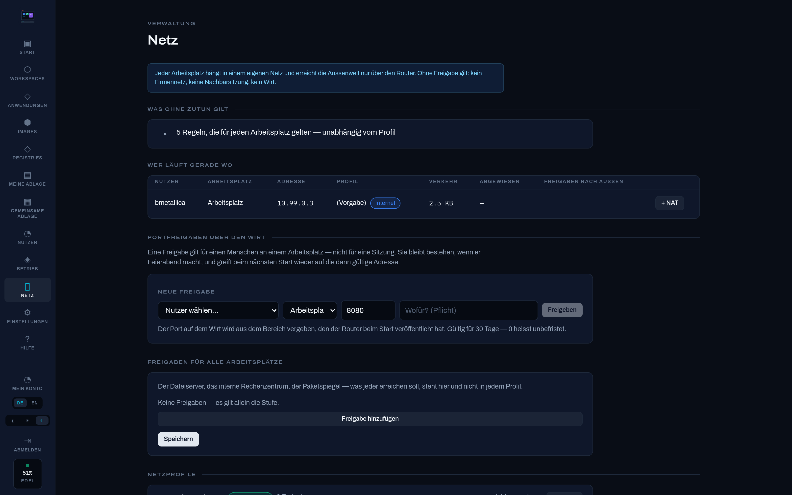

*Was ohne Zutun gilt, steht ausgeklappt da — mit Grund und Herkunft je Zeile. Darunter, wer gerade
wo arbeitet, mit Durchsatz und verworfenen Paketen, und der Knopf für eine befristete Portfreigabe.*

#### Wo ein Paket endet, und warum


Die Vorgabe. **Die dritte Zeile ist die wichtigste**: Zum Nachbarn wird nichts *verworfen* — dorthin
führt gar keine Leitung. Eine Regel kann falsch sein, ein fehlender Weg nicht.


Und die Gegenrichtung: Eine Portfreigabe („+ NAT") ist der einzige Weg von aussen hinein — über
einen benannten Port, und nur solange die Frist läuft. Die übrigen drei Diagramme — *abgeschottet*,
*aus* und eine Freigabe nach Namen — stehen in
[Handbuch, Kapitel 23](docs/wiki/23-netz.md). Erzeugt werden sie von
[`scripts/netzfluss.py`](scripts/netzfluss.py); wer Bewegung abgestellt hat, sieht dasselbe Bild
mit stehenden Paketen.

### Betrieb und Überwachung

- **Live-Auslastung** unter **Betrieb → Arbeitsplätze**: Balken für CPU, RAM und Netz je
  Arbeitsplatz und für den Host. Eine Warnung erscheint, sobald die CPU-Grenze einen Container
  bremst. Dieselbe Liste zeigt alle Arbeitsplätze aller Nutzer, laufend und angehalten, mit Platz
  und „zuletzt aktiv". Von dort lassen sie sich starten, anhalten und löschen, oder man öffnet das
  **root-Webterminal** ([Kapitel 11](docs/wiki/11-betrieb.md#live-auslastung-betrieb--arbeitsplätze-))
- **LXCFS** richtet `make up` auf dem Host selbst ein. Neue Arbeitsplätze bekommen es über Docker,
  bestehende beim nächsten Start oder Fortsetzen; das gilt auch für Root-Arbeitsplätze unter
  Sysbox. Mit `OTA_LXCFS=aus` bleibt es weg
  ([Kapitel 11](docs/wiki/11-betrieb.md#im-arbeitsplatz-lxcfs-und-ota-top-))
- **Startbalken und Startprotokoll**: Auf der Kachel steht, was beim Start gerade passiert. Im
  Protokoll des Agents steht je Start eine Zeile mit der Dauer jedes Schritts
  ([Kapitel 25](docs/wiki/25-root-arbeitsplatz.md#startzeit))
- **`/healthz` und `/metrics`** für die Überwachung von außen
- **Protokolle**: Unter **Betrieb → Protokoll** stehen Anmeldungen, Sitzungen,
  Verwaltungsvorgänge, Aufschalten und Auskünfte. Verhaltensdaten verfallen nach 90 Tagen,
  Verwaltungsvorgänge nach 365. Aufgeräumt wird täglich, und das Aufräumen steht selbst im
  Protokoll
- **Nichts wächst ohne Grenze.** Container-Protokolle sind auf 10 MB × 3 gedeckelt, für die
  Dienste **und** für jeden Arbeitsplatz
- **Sicherung und Wiederherstellung** von Profil, Container und Datenbank, auch für
  Root-Arbeitsplätze und OTA-Git, manuell und nach Plan, mit Aufbewahrungsregel
  ([Kapitel 14](docs/wiki/14-sicherung.md))
- **Updates in einem Schritt** (`make update`), siehe [Aktualisieren](#aktualisieren). Während des
  Updates zeigt jede OTA-Seite ein Banner. Dazu kommen die **Sicherheitsupdates** bei jedem
  `make update`: frische Basis- und Dienst-Images, die Paket-Updates der Woche, und eine neue
  Forgejo-Fassung übernimmt OTA-Git von selbst. **`make cve`** listet die behebbaren Lücken je
  Image, gescannt mit grype ([Kapitel 11](docs/wiki/11-betrieb.md#sicherheitslücken-cves-))
- **Stückliste je Image** (`make sbom`) in SPDX und CycloneDX. Sie wird gebraucht, sobald ein Image
  das Haus verlässt
- **Firmenproxy** durchgängig: beim Bauen der Dienste und der Images, in jeder Sitzung, in API,
  Agent und Paketquelle. Auch dort, wo keine Umgebungsvariable hinreicht, bekommt etwa `apt` eine
  eigene Konfiguration. Umschaltbar im laufenden Betrieb, ohne Neuaufsetzen
  ([Kapitel 21](docs/wiki/21-firmenproxy.md))
- **HTTPS ab Werk** mit eigener kleiner CA, austauschbar, oder hinter einem weiteren Reverse Proxy
  (nginx, Caddy …). Auch **hinter einer Firewall mit NAT** läuft OTA, ohne Hairpin-NAT
  ([Kapitel 10](docs/wiki/10-zertifikate-und-https.md), [24](docs/wiki/24-hinter-nat.md))
- **Datenorte**: Datenbanken, Registry, OTA-Git und die Docker-Daten der Root-Arbeitsplätze lassen
  sich über `.env` auf eine eigene Platte legen, etwa eine SSD; die Nutzerdaten bleiben auf der
  großen. `scripts/daten-umziehen.sh` zieht im laufenden Betrieb um und schaltet in Sekunden um.
  Laufende Root-Arbeitsplätze werden nie angehalten, sondern beim nächsten Fortsetzen umgeschaltet.
  Liegt `/srv/ota` mit den Nutzerdaten auf der Systemplatte, zieht `scripts/srv-umziehen.sh` es als
  Ganzes auf die große Platte, der Pfad bleibt per Bind-Mount derselbe
  ([Kapitel 40](docs/wiki/40-datenorte.md))
- **Die eigene Marke**: Name der Anlage, Akzentfarbe und Zeichen. Sie erscheinen im Browserreiter,
  auf der Anmeldemaske (auch der von Keycloak), auf dem Startbildschirm und in der PWA
  ([Kapitel 22](docs/wiki/22-marke.md))
- **News schreiben**: Meldungen der Verwaltung an alle, in Markdown mit Zeilenumbrüchen und
  gefiltertem HTML direkt auf der Seite geschrieben. Es gibt Entwürfe, Anheften und einen Punkt in
  der Seitenleiste für Ungelesenes ([Kapitel 11](docs/wiki/11-betrieb.md#news-))
- **Standardsprache** für alle, die nicht selbst umschalten. Sie gilt auch für die Anmeldeseite von
  Keycloak und das Handbuch
- **Diagnose-Skripte** für die Fälle, die nach etwas anderem aussehen, als sie sind:
  - `docker-diagnose.sh` klärt, warum Docker auf dem Host langsam ist;
  - `platten-last.sh` zeigt, wer die Platte belastet;
  - `platz-diagnose.sh` findet heraus, warum ein Arbeitsplatz kein Netz hat.

  [Kapitel 12](docs/wiki/12-fehlersuche.md) beschreibt echte Fehler mit Symptom, Ursache und
  Reparatur.
- **Kein Nachladen von fremden Hosts.** Die Schriften liegen bei, und die Oberfläche fordert nichts
  aus dem Internet an. Sie sieht offline und hinter einem Firmenproxy gleich aus, und die
  IP-Adresse keines Nutzers verlässt das Haus
- **Läuft neben einer bestehenden Kasm-Installation** auf demselben Host, ohne dort etwas
  umzustellen

### Streaming und Basisimage

- **Eigenes Basisimage** `ota/base-desktop`: Debian 13 + XFCE + **Selkies**, ohne Anwendung und
  **ohne fremde Streaming-Software**. Es überträgt H.264 über WebSockets durch denselben HTTPS-Port
  wie die Oberfläche, statt rechteckiger Ausschnitte über RFB. Das Konto heißt `ota` und wohnt
  unter `/home/ota`; kein Bestandteil trägt „Kasm" im Namen.
  `scripts/build-desktop-image.sh --pruefen` misst die Punkte des Vertrags mit dem Agent
  ([Kapitel 19](docs/wiki/19-eigenes-basisimage.md))
- **Selkies 2.0 als Fork in OTAs Repository** (`third_party/selkies/`). So bricht ein Wechsel beim
  Original den Bau nicht mehr, wie es beim Verschwinden von 1.6.2 am 2026-10-07 geschah. Als Paket
  `ota-selkies` hebt es auch ältere Golden Images an ([Kapitel 20](docs/wiki/20-selkies-versuch.md))
- **`ota/base-desktop-root`** für Root-Arbeitsplätze (`make root-image`)
- **Der ältere Weg bleibt**: `ota/base-xfce` (Ubuntu + KasmVNC) für Images von Kasm, die kein
  Selkies mitbringen. Umschaltbar je Arbeitsplatz unter **Streaming**;
  `scripts/build-base-image.sh --pruefen` prüft ihn weiterhin
- **`make messung`** vergleicht die beiden Streaming-Wege unter derselben Last: CPU, Bandbreite
  und Reaktionszeit je Sitzung

## Ein Blick in die Verwaltung

| | |
|---|---|
| 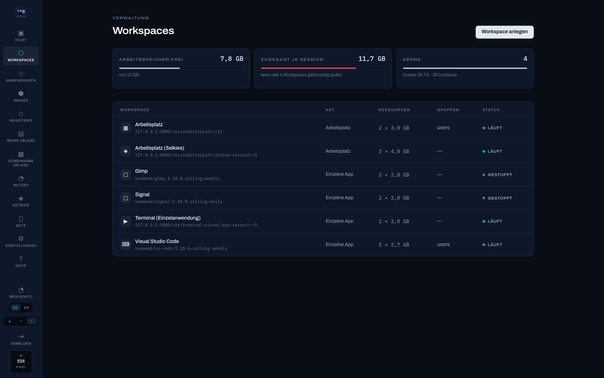 | 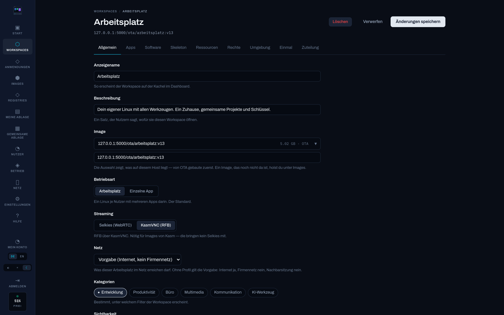 |
| **Was der Host trägt.** Die zweite Anzeige steht rot: Liefen alle vier Vorlagen gleichzeitig, wäre die Maschine überbucht. Das sieht man vorher, nicht im OOM-Kill. | **Die Vorlage.** Ein Bildschirm je Arbeitsplatz — Image, Betriebsart, Streaming-Weg und was er im Netz darf. |
| 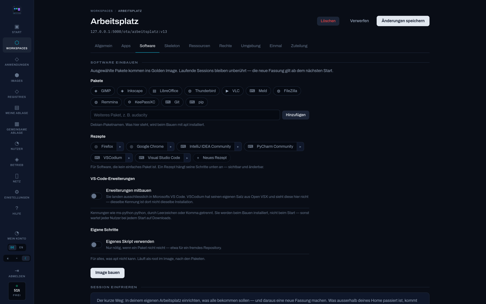 | 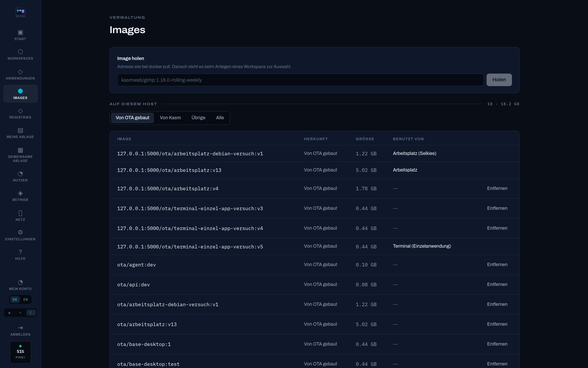 |
| **Software hinein.** Pakete anklicken oder ein Rezept wählen, dann bauen; das Protokoll läuft live mit. Darunter der kurze Weg: eine Session einfrieren. | **Die Images.** Was auf dem Host liegt, woher es kam, wer es benutzt — und was sich gefahrlos entfernen lässt. |
| 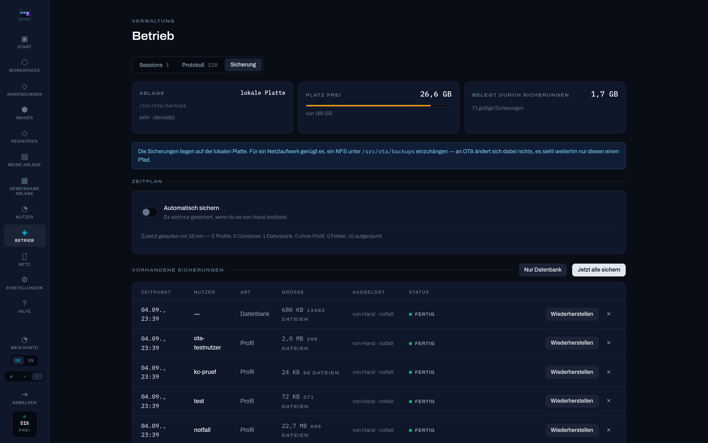 | 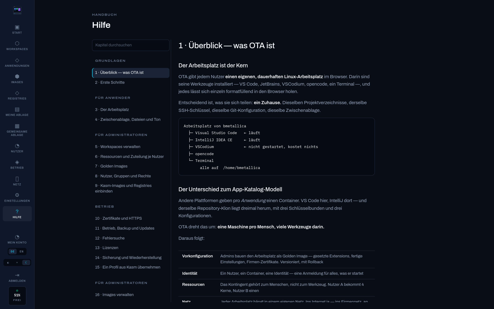 |
| **Die Sicherung.** Profile, Container, Datenbank und Inhalte — von Hand oder nach Plan, mit Aufbewahrungsregel. | **Das Handbuch liegt im Programm.** Welche Kapitel jemand sieht, entscheiden seine Rechte. |

Die Bilder entstehen mit `make bilder` — [`tests/screenshots.mjs`](tests/screenshots.mjs) meldet sich
an, fährt die Bildschirme ab und räumt hinterher auf. Zwei Dinge tut es dabei **nicht**: sich auf
eine fremde Sitzung schalten (es startet eine eigene) und Bildschirme mit Personenlisten aufnehmen.

## Wie es gebaut ist

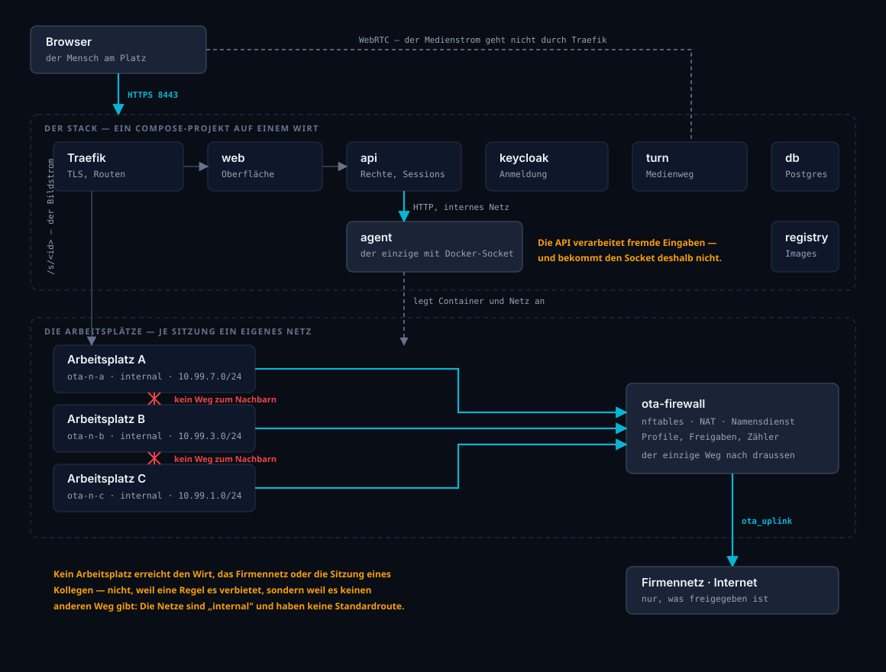

Zwei Aussagen stecken in diesem Bild, und beide sind die Antwort auf einen Befund:

**Nur `agent` fasst Docker an.** Die API verarbeitet Nutzereingaben und bekommt den Socket deshalb
nicht — dieselbe Trennung gilt für das Dateisystem des Hosts.

| Verzeichnis | Inhalt |
|---|---|
| `web/` | Oberfläche (React, TypeScript, handgeschriebenes CSS, keine UI-Bibliothek) |
| `api/` | REST-API, Anmeldung, Rechte, Sessions (FastAPI, PostgreSQL) |
| `agent/` | **Einziger** Dienst mit Docker-Zugriff; Container, Displays, Images, Ablage, LXCFS, `ota-top` |
| `deploy/` | Compose-Stack, Traefik, Registry, Zertifikate |
| `firewall/` | Der Router aller Arbeitsplätze: nftables, NAT, Namensdienst, Portfreigaben |
| `extension/` | Firefox-Erweiterung für die Zwischenablage |
| `docs/wiki/` | Handbuch — wird im Programm als Hilfe ausgeliefert; Englisch in `docs/wiki/en/` |
| `ki/` | Der KI-Durchgang `ota-ki`: ein Eingang für alle KI-Server, Modellverzeichnis, Nutzungszahlen |
| `repo/` | Die eigene Paketquelle samt Spiegel und Verwaltung |
| `packaging/` | Die Pakete `ota-selkies`, `ota-ide-ai` und `ota-opencode` |
| `images/` | Eigene Basisimages: `base-desktop` (Debian + XFCE + Selkies, Vorgabe), `base-desktop-root` (für Root-Arbeitsplätze), `base-xfce` (Ubuntu + KasmVNC) und `turn` |
| `third_party/selkies/` | Der Fork von Selkies 2.0 mit OTAs Anpassungen |
| `tests/`, `scripts/` | Prüfungen, Einrichtung (Sysbox, LXCFS), Zertifikat, Migration aus Kasm, Datenumzug, Diagnose, Stückliste |

## Dokumentation

- **[Handbuch](docs/wiki/README.md)** — Bedienung, Verwaltung, Betrieb, Fehlersuche (40 Kapitel,
  davon acht eigens für Anwender; [English](docs/wiki/en/README.md))
- **[plan.md](plan.md)** — Architektur **und die Begründungen dahinter**, samt der Sackgassen
- **[docs/adr/](docs/adr/README.md)** — Entscheidungen, die teuer rückgängig zu machen sind, mit den
  Alternativen, die nicht getragen hätten
- **[roadmap.md](roadmap.md)** — Umsetzungsstand, ehrlich
- **[dsgvo.md](dsgvo.md)** — welche personenbezogenen Daten wo liegen, wie lange, wer sie sieht —
  und die vier Stellen, an denen heute etwas fehlt
- **[firewall.md](firewall.md)** — die Netzabsicherung der Arbeitsplätze: ein Netz je Sitzung, ein
  Router davor, Profile und Portfreigaben in der Oberfläche — samt der vier Dinge, die beim Bauen
  anders kamen als geplant

Ein Hinweis zur Fehlersuche: [Kapitel 12](docs/wiki/12-fehlersuche.md) beschreibt echte Fehler aus
dem Betrieb mit Symptom, Ursache und Reparatur — darunter mehrere, die tagelang nach etwas anderem
aussahen, als sie waren.

## Prüfungen

```bash
make test
```

**Über zwanzig Prüfreihen**, jede stellt ihren Vorzustand selbst her:

| Suite | Prüft |
|---|---|
| `test-authz.sh` | Ein normaler Nutzer kann beweisbar nichts Administratives tun und an keinem fremden Bildschirm sitzen; dazu Container-Härtung, Kennzahlen, Kontingente und zweiter Faktor |
| `test-ressourcen.sh` | Geänderte CPU und RAM erreichen vorhandene Container, laufend und pausiert; RAM unter dem Verbrauch wartet bis zum nächsten Start, die CPU nicht; Kerne sind Gewicht, ein Container mit einem Kern nutzt bei freiem Host mehr; die Live-Auslastung sieht diese Last |
| `test-software.sh` | Softwaremonitoring: Die Erfassung liest einen laufenden Arbeitsplatz (Debian-Pakete wie `apt-mark showmanual`, Starteinträge systemweit und im Zuhause, versteckte nicht); nach dem Befüllen der Whitelist keine Meldung; eine neue Anwendung wird mit Nutzer gemeldet; deinstalliert oder freigegeben verschwindet die Meldung, entzogen kommt sie wieder |
| `test-git.sh` | OTA-Git: Ein- und Ausschalten (Daten bleiben), Subdomain hinter Traefik mit OTA-CA, OTA unberührt, Eingänge für Arbeitsplätze nicht auf dem Host; Anmeldung über Keycloak nur für berechtigte Gruppen, vorab angelegtes Konto wird verknüpft, Admins sind Admins, gesperrt statt gelöscht; im Arbeitsplatz clone/push ohne Passwort, eigene .gitconfig gewinnt, fremder Server bekommt nichts, SSH über 2222, Token widerrufen bei Ende, Root-Arbeitsplatz mit neuem Token nach dem Fortsetzen; andere Subdomain; nginx als Reverse Proxy; Sicherung mit Repositories |
| `test-root-arbeitsplatz.sh` (Ergänzung) | Ein Einmal-Skript, das einem angehaltenen Root-Arbeitsplatz zugewiesen wird, läuft beim Fortsetzen als 1000 und steht mit Rückgabewert und Ausgabe unter „Läufe ansehen" |
| `test-gemeinsame-daten.sh` | Gemeinsame Daten: zwei Root-Arbeitsplätze desselben Kontos laufen gleichzeitig, jeder mit eigenem Zuhause; Datenordner (auch verschachtelt) in beiden dieselben und im gemeinsamen Zuhause auf dem Wirt, Besitzer 1000; Einstellungen getrennt; Ordner mit `..`, versteckte und unbekannte Persistenz abgelehnt; Pakete kommen trotz abgelehntem `put_archive` in den Root-Container; ein verschwundener Container wird angehalten statt als „läuft“ stehen zu bleiben und startet mit denselben Daten neu |
| `test-duplizieren.sh` | Duplizieren: Einstellungen, Apps samt Startbefehl, Einmal-Skript, Zuteilung je Nutzer, Gruppen und Skeleton (auch je Anwendung, Besitzer 1000) kommen mit; eigene Kennung, ausgeschaltet, Quelle bleibt unberührt; nur mit Verwaltungsrecht; ein geteiltes Image gilt als anderswo genutzt. Eigener Name: gilt nur für den Nutzer, Vorlage und Admin unberührt, zu lang abgewiesen, nicht für unsichtbare Vorlagen, leer setzt zurück, geht mit der Vorlage |
| `test-news.sh` | News: lesen alle, schreiben nur mit `settings.manage`; Entwurf unsichtbar und nicht neu; Veröffentlichen zählt für die Seitenleiste, Öffnen setzt zurück, Korrektur zählt nicht erneut; Angeheftetes oben; Text unverändert gespeichert; Anlegen, Ändern, Löschen im Protokoll |
| `test-ide-ai.sh` | IDE-AI: Modelle vom KI-Server abrufen, falsche Eingaben abgewiesen, API-Schlüssel bleibt auf dem Server, Testfrage; Pakete in der Paketquelle, nur der Agent bekommt die Datei; in jeder Vorlage mit Editor config.yaml mit Marke, Kontextfenster und Antwortlänge, Telemetrie aus, Continue in VS Code/VSCodium und JetBrains verknüpft, Firewall lässt den KI-Server durch, Frage aus dem Arbeitsplatz bekommt Antwort, eigene config.yaml bleibt; „neu einrichten“ räumt Marketplace-Kopien in JetBrains und VSCodium weg, schaltet Continue ein und legt die eigene config.yaml beiseite; ausgeschaltet ist alles wieder weg |
| `test-opencode.sh` | opencode und Erweiterungen: Einstellungen und Vorschau, Unsinn abgewiesen; Gedächtnis koppeln (falscher Schlüssel abgewiesen), konfigurieren, Embeddings testen, Traefik-Wege; im normalen Arbeitsplatz mit Editor installiert sich opencode neben IDE-AI; im Root-Arbeitsplatz verwaltete Konfiguration, Prompt-Zusatz, Token, Paket; MCP aus dem Arbeitsplatz, der Vertrag nicht; opencode mit Fake-Modell: echte Sitzung statt gefälschter, Unteragent schreibt in die Wurzelsitzung, neue Sitzung sieht nichts, Felder `ota_*` für das Modell unsichtbar; Ansicht nur angemeldet und nur eigene Arbeitsplätze, gefälschte Kopfzeilen wirkungslos; Übernahme einer eigenen Installation, eigenes Standardmodell bleibt; Anhalten widerruft, Fortsetzen gibt neues Token, Gedächtnis ist wieder da |
| `test-konten.sh` | Konten der zentralen Anmeldung: Anlegen in OTA legt in Keycloak an (samt Pflicht zum Passwortwechsel), lokal kommt es nicht herein; Ändern, Passwort, zweiter Faktor, Sperren und Löschen wirken in Keycloak; Mein Konto führt über Keycloak; ein lokales Bestandskonto zieht mit seinem Passwort um, das Notfallkonto nicht |
| `test-clipboard-bridge.sh` | Kopieren zwischen zwei Anwendungen im selben Arbeitsplatz: beide Richtungen, Umlaute, ein Bild, ein Megabyte, nach Pause, und abgeschaltet |
| `test-i18n` (`scripts/i18n-pruefen.py`) | Zweisprachigkeit: Jeder Text der Oberfläche und jede Meldung des Servers hat einen englischen Eintrag, kein deutscher Text geht an der Übersetzung vorbei, und jedes Kapitel des Handbuchs gibt es auf Englisch mit demselben Aufbau |
| `tests/e2e.mjs` | Die Oberfläche in einem echten Browser — bis zur Frage, ob der Stream wirklich verbindet |
| `test-verzeichnis.sh` | Gruppen aus dem Verzeichnis: beide LDAP-Gruppenformen werden erkannt, eine gekoppelte OTA-Gruppe bekommt ihre Mitglieder bei der Anmeldung und beim Abgleich, von Hand Aufgenommene bleiben, eine LDAP-Gruppe „admins“ macht niemanden zum Admin, Konten ohne Gruppe bekommen den Hinweis; eine Anwendung lässt nur ihre Gruppen herein, über das Formular **und** die SSO-Sitzung, ohne Gruppe niemanden; wer im Verzeichnis fehlt, wird deaktiviert |
| `test-verknuepfen.sh` | Domänenkonto einem bestehenden Konto zuordnen: Danach gibt es nur das alte Konto, mit derselben Kennung, Sitzung und demselben Zuhause, unter dem Namen aus dem Verzeichnis; das Konto aus der ersten Domänenanmeldung ist weg; das alte Passwort und das alte Keycloak-Konto gelten nicht mehr; das Notfallkonto lässt sich nicht verknüpfen; für Konten aus Keycloak und für lokale Bestandskonten |
| `test-ldap.sh` | Verzeichnis-Anbindung **über Keycloak** gegen ein echtes OpenLDAP im Container — vor allem, dass ein Verzeichniseintrag kein lokales Konto übernimmt und ein Ausfall den Notzugang nicht mitreisst |
| `test-streaming.sh` | Der Medienweg mit einer eigenen Vorlage auf dem aktuellen Basisimage: Ein Browser in einem fremden Netz zählt die **dekodierten Bilder** — auf dem Arbeitsplatz und auf dem Bildschirm einer Anwendung (Selkies 2.0, WebSockets durch Traefik); Umlaute, Shift und AltGr einer deutschen Tastatur kommen richtig an. Ist TURN eingerichtet (nur noch für Golden Images mit Selkies 1.6.2), wird er mitgeprüft, samt Sperrliste und NAT |
| `test-firewall.sh` | Die Netzabsicherung, **von innen gemessen**: Nachbar, Wirt, Firmennetz, TURN, Namensdienst, Internet je Stufe, Freigabe nach Namen, Portfreigabe — und alles noch einmal nach einem Neustart des Routers |
| `test-lxcfs.sh` | LXCFS und `ota-top`: Speicher und Kerne nach den Grenzen im normalen Arbeitsplatz, in einem ohne LXCFS angelegten Root-Arbeitsplatz nach Fortsetzen und nach Starten durch die Verwaltung, in einem neuen Root-Arbeitsplatz über Anhalten und Fortsetzen. Ohne LXCFS übersprungen |
| `test-root-arbeitsplatz.sh` | Der Root-Arbeitsplatz: root auf dem Host unprivilegiert (Sysbox), Docker und Compose im Container, Netzregeln auch für die **inneren** Container, Anhalten und Fortsetzen mit erhaltenem Stand, Neu aufsetzen, Webterminal samt Protokoll und Export, kein Terminal in Dienste des Stacks, Golden Images mit `USER 1000`, Startbalken und Startprotokoll bei Start und Fortsetzen. Ohne Sysbox übersprungen |
| `test-repo.sh` | Die eigene Paketquelle: Signatur, Hochladen (doppelt 409, kaputt 422), Snapshots samt Schutz vor dem Löschen, ein Debian-13-Arbeitsplatz installiert ein eigenes Paket **von hier**, „Nur Spiegel" ruft `deb.debian.org` nicht mehr, der Bildbauer trägt ein und wieder aus, ein Ubuntu-Image bleibt unberührt, ein Root-Arbeitsplatz übernimmt beim Fortsetzen die aktuelle Einstellung. Die Spiegelteile nur mit Spiegel |
| `test-selkies-paket.sh` | Das Paket `ota-selkies`: liegt in der Paketquelle, hebt einen Arbeitsplatz auf einem alten Golden Image mit Selkies 1.6.2 an, der Bildbauer hebt ein Golden Image an, ein Root-Arbeitsplatz hebt sich beim Fortsetzen an und behält, was darin installiert war |
| `test-ki.sh` (einzeln, braucht einen echten KI-Server) | KI-Durchgang und Nutzungsstatistik: `ki.ota` im Arbeitsplatz, Modellverzeichnis über den Durchgang, Antwort über `ki.ota` und über die abgefangene echte Adresse, Continue und opencode ohne Schlüssel; Anfragen stehen mit Tokens beim Menschen, Anwendungen werden erkannt, Prüfabrufe ohne Modell zählen nicht; Filter nach Quelle, Modell und Anwendung, keine Zahlen bei weniger als drei Menschen; Auskunft nur mit Begründung; fällt `ota-ki` aus, geht der Verkehr direkt |
| `test-backup.sh` | Sicherung und Wiederherstellung von Profil, Container und Datenbank. Beendet dafür Sitzungen — **nur die eigenen**, und prüft das ausdrücklich nach |

Die Zugangsdaten der Prüfung stehen in `deploy/.env` und nicht im Quelltext; die Reihen lesen sie
von dort selbst, ein `make` davor ist also nicht nötig.

Daneben steht `make messung` — **keine Prüfung, sondern eine Messung**: Sie vergleicht die beiden
Streaming-Wege unter derselben Last und sagt, was eine Sitzung an CPU, Bandbreite und Reaktionszeit
kostet. Sie dauert eine Viertelstunde und braucht eine ruhige Maschine, deshalb läuft sie nicht bei
`make test` mit. Ergebnisse und Auswertung: [Kapitel 20](docs/wiki/20-selkies-versuch.md#was-es-kostet--gemessen).

Ein voller Lauf dauert **rund eine halbe Stunde**: Er startet Container, friert ein Image ein und
misst im Browser nach. Jede Suite lässt sich einzeln starten (`bash scripts/test-authz.sh`).

Die Reihe für den Medienweg gibt es, weil die teuersten Fehler dieses Projekts genau dort lagen und
keine andere sie gefunden hätte: ein TURN-Server hinter einer Docker-Bridge, der die falsche
Absenderadresse verschickt; ein DTLS-Paket, das an einer kleinen MTU zerschellt. Beide sahen im
Browser gleich aus — „Waiting for stream" — und standen in keinem Protokoll.

## Lizenz

**Apache-2.0** (siehe [LICENSE](LICENSE)). Gewählt, weil OTA Infrastruktur ist: keine Auflagen für
den Betreiber, ausdrückliche Patentfreigabe, und dieselbe Wahl wie beim nächstverwandten offenen
Projekt (Apache Guacamole).

OTA **enthält** keine fremde Software: Abhängigkeiten werden beim Bauen geholt, Bestandteile zur
Laufzeit als Container-Images bezogen. **Sie behalten ihre eigenen Lizenzen und werden von OTA nicht
neu lizenziert** — aufgeschlüsselt in drei Ebenen in
[THIRD-PARTY-NOTICES.md](THIRD-PARTY-NOTICES.md), knapp in [NOTICE](NOTICE).

Ein Arbeitsplatz-**Image** ist ein zusammengesetztes Werk: OTA-Konfiguration, Selkies (MPL-2.0,
**von OTA verändert**), libx264 (GPL-2.0+), XFCE, hunderte Distributionspakete, die installierten
Anwendungen. Es ist **nicht** „Apache-2.0".

Das Basisimage **darf weitergegeben werden** — mit vier Pflichten: Quellen für die GPL-Teile
anbieten, die fünf Selkies-Patches beilegen (MPL-2.0 wirkt dateiweise), Lizenztexte im Image
lassen und eine Stückliste mitliefern. Fertige Arbeitsplätze mit Microsoft VS Code oder Google
Chrome dagegen **nicht** — dieselben mit VSCodium und Firefox schon.

**Für die Anwendungen in einem Golden Image gilt deren eigene Lizenz.** Bei Microsoft VS Code ist
der Betrieb im eigenen Unternehmensnetz ausdrücklich erlaubt, die Weitergabe an Dritte nicht.
Mit Originalzitaten geprüft in [Handbuch, Kapitel 13](docs/wiki/13-lizenzen.md) — keine
Rechtsberatung, aber am Lizenztext und nicht aus dem Gedächtnis.

„Kasm" ist eine Marke von Kasm Technologies. OTA ist kein Kasm-Produkt und steht in keiner
Verbindung zu Kasm Technologies.
