# 23 · The workspaces' network ✅

*For administrators.*

Every workspace sits in its **own network**. All these networks end in a router (`ota-firewall`), and
the router is the only way out. There is no way around it — the networks are set up so that Docker
itself sets up no NAT and assigns no default route.

**That is the difference from a collection of rules**: the protection is a property of the
structure. If the router lets nothing through, nothing gets through — not because a rule applies, but
because there is no other way.

Found under **Network**. It needs the permission `settings.manage`.

## What applies without any action

| Destination | |
|---|---|
| The internet | ✅ allowed |
| The company network (all private ranges) | ❌ closed |
| A colleague's workspace | ❌ closed |
| The host OTA runs on | ❌ closed |
| The TURN server, OTA itself, name resolution | ✅ allowed — OTA and name resolution always, TURN for images with Selkies 1.6.2 |

That is the level **Internet**, and it applies to every workspace without a profile of its own.


**The third row is the most important.** Nothing is *dropped* towards the neighbour — there simply is
no line there. The difference matters: a rule can be wrong, a missing path cannot.

### The base rule set — what OTA opens for itself

The last row of the table is shown expanded in the interface: **Network → What applies without any
action.** Every rule is listed there individually, with **destination, ports, protocol, reason and
origin**:

| Destination | Ports | Why |
|---|---|---|
| The TURN server | 3478 and the relay range | The media path of Selkies 1.6.2 (golden images on the old base image). Selkies 2.0 does not need it. |
| OTA itself | 8443 | The browser in the workspace loads the clipboard extension from there. |
| The router itself | 53 | Name resolution. No other name service is reachable. The router in turn asks the host's name servers or `OTA_FW_DNS_UPSTREAM` — **that** is what the outer firewall must let through, not the rules here. |
| Traefik → workspace | 6901, 8080 | The opposite direction: the video stream. |
| The corporate proxy | as configured | Only if one is set. |
| Time server | 123 | Only if one is set. A wrong clock breaks TLS. |
| Published TURN address → host | 3478 | Only behind NAT: the router redirects the firewall's address to the host ([chapter 24](24-hinter-nat.md)). |

**This list is derived, not entered.** The values come from `deploy/.env` (`OTA_TURN_HOST`,
`OTA_TURN_BIND`, `OTA_SELF_ADDRESS`, `OTA_HTTP_PROXY`, `OTA_NTP_HOST` …) and from the structure
itself. That is why it can be **seen** in the interface but not changed — it is changed where it
comes from. It still has to be visible: otherwise there would be a firewall nobody knows what it lets
through anyway, and the first question with every problem would be whether TURN is allowed at all.

## The bundled profiles

Every installation brings two profiles. They are created at the first start and are **never
overwritten** — whoever rebuilds them did so on purpose.

| Profile | Level | What for |
|---|---|---|
| **Standard** | internet | Internet yes, company network no. The same as what applies without a profile — but visible. |
| **Isolated** | isolated | Only what OTA itself needs. For workspaces that only handle local data. |

**A profile with the level "off" is deliberately not bundled.** It lifts every restriction and
requires a justification; a bundled one would be one nobody wrote — and a profile that only needs to
be assigned gets assigned.

## The three levels

| Level | Meaning |
|---|---|
| **Isolated** | Only what OTA itself needs. No internet, no company network. For workspaces that only handle local data. |
| **Internet** *(default)* | As above. |
| **Off** | The router lets everything through. |



**Isolated** does not mean "disconnected": the base rule set still applies, otherwise no picture would
arrive in the browser. Whatever goes beyond it ends in the router.



**"Off" does not mean "without a firewall".** The picture above shows it: the workspace still hangs
on the same cable and still goes through the router — which just no longer filters, and **there is
no line to the neighbour here either.** That is not a rule that could be switched off; it is the
structure. The level requires a justification and is recorded in the audit log
(`netprofile.opened`).

## Rules

Two lists, both with the same form: **destination · ports · protocol · note**.

* **Global** — what applies to *all* workspaces: the file server, the internal data centre, the
  package mirror. Maintained in one place instead of repeated in every profile.
* **Per profile** — what only this group of workspaces needs.

A destination can be an address (`192.168.66.10`), a range (`10.20.0.0/16`) **or a name**
(`git.company.com`). Ports individually (`443`), as a list (`80,443`) or as a range (`8080-8090`).

**The note is mandatory.** A rule without a justification is, in a year, one nobody dares to remove.



### Why names work although a firewall knows no names

The router is also the workspaces' name service. When it hands out an answer, it enters the same
address into a list — with the answer's lifetime. Rule and connection thus come **from the same
lookup** and cannot drift apart.

The obvious way — resolving the name every few minutes and entering the address — does not work for
anything with a short lifetime or several addresses: the browser then gets a different address than
the one entered, and access fails seemingly without reason.

**No other name service is reachable**, and that is intentional: whoever could ask `8.8.8.8` would
get addresses that are in no list — and the name rules would be ineffective. (Names over encrypted
DNS in the browser bypass even that. That is the limit of every name-based rule.)

## Docker in root workspaces

Containers running in a root workspace ([chapter 25](25-root-arbeitsplatz.md)) hang behind the
workspace and go **through the same router** — with the same profile. Measured: from an inner
container internet yes, company network no, host no. Their name service is the router (the inner
`dockerd` runs with `--dns` pointing at it); a foreign resolver stays closed for them too.

## The network overview

Who is working under which address right now, with which profile, how much goes through the line —
and how many packets were dropped.

**The dropped packets are the most interesting field.** A workspace that suddenly addresses a hundred
different destinations in the company network is a port scan — and looks exactly like that in this
number. The numbers are live and stored nowhere; whoever builds a time series from them creates
personal data ([data protection](../../../dsgvo.md)).

### Fixed addresses

Every pair of **person and workspace** gets a network and keeps it. Whoever works under
`10.99.7.10` today does so again tomorrow — after hours too, after a restart too. Without that an
upstream firewall in the company could not be configured for a workspace.

## Publishing a port to the outside ("+ NAT")

When someone wants to test their own application in the workspace and it should be reachable from
outside: **Network → Port forwards → New forward**, or the **+ NAT** button in the row of a running
workspace.


Three things are asked: which port in the workspace, for how long, and **what for**. The port on the
host is assigned — from the range the router published at start (30000–30019 by default). The person
gets "reachable at `<host>:30003` until 12 Sep."

* The forward is tied to **person and workspace**, not to the session. It survives the end of the
  working day, stays in the list (marked "waiting for start") and applies again at the next start.
* **The expiry is enforced**, not just displayed. Once the time is up, the rule disappears at the
  next sync.
* `0 days` means unlimited. Allowed — but a decision, and it is in the audit log.

**Such a thing is requested outside OTA** (an email to administration is enough). OTA represents the
decision, not the request.

If the port range is not enough, it can be enlarged in `.env` (`OTA_NAT_MIN`, `OTA_NAT_MAX`) — **that
requires a restart of the router, and that briefly disconnects all workspaces.** Every port also costs
a rule and a helper process; that is why there are twenty by default and not a thousand.

## When something does not work

| Picture | Cause |
|---|---|
| "The intranet does not work" | Default. The company network is closed — enter a rule, globally or in the profile. |
| An application in the workspace does not get to the internet | The profile is set to **isolated**. The user's dashboard shows what applies. |
| An allowed **name** does not work | If the application uses encrypted DNS (DoH), it does not ask the own name service — then the rule does not apply. Enter the address instead of the name. |
| After a restart of the router nobody has network | The sync restores the connection; it runs every 30 seconds. If it stays that way, `docker logs ota-firewall` says why. |
| No picture any more, but the session is running | Not the network: the video stream goes through Traefik, not through the router. See [chapter 12](12-fehlersuche.md). |

## The pictures

The five diagrams above are generated by `python3 scripts/netzfluss.py` — they only differ in the
verdicts on the lines, and by hand they would be five files that drift apart as soon as someone
changes a colour. The English versions are generated with `OTA_NETZFLUSS_SPRACHE=en` into
`docs/wiki/en/bilder/`. They are animated with CSS and not with SMIL; only that way can
`prefers-reduced-motion` be respected. **Whoever has turned off motion sees the same picture with
packets standing still** — not an empty one.

## Checking

```bash
scripts/test-firewall.sh
```

Starts two workspaces with different profiles and measures **from inside**: neighbour, host, bridge,
company network, TURN, OTA, name resolution, foreign name service, internet per level, a rule by name
(allowed and forbidden), a port forward on and off again — and everything again after a restart of
the router. Runs with `make test`.

**From inside and not on the rule set**, and that is no detail: while building, the rule set was
complete three times, and still something was open — the host's bridge needed no rule to be
reachable.
